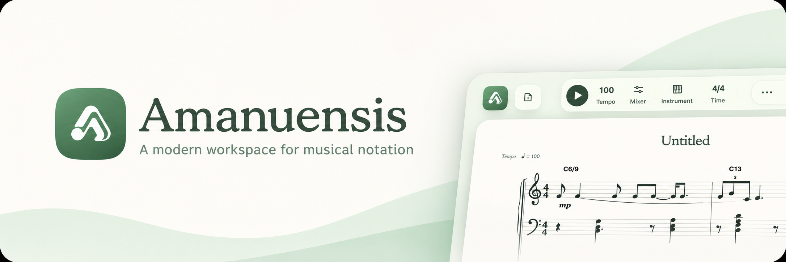

# Amanuensis

An agentic music notation editor. You tell it what to write by talking, singing, or showing it a page of sheet music, and an agent puts it into the score. In Band Mode, each instrument gets its own agent: they work on their parts at the same time and check them against each other. Built on Meta’s **Muse Spark** and **Muse Voice Transcribe**.

## Contents

1. [Setup](#setup)
2. [Recording a melody](#recording-a-melody)
   - [How to get the notes right](#how-to-get-the-notes-right)
   - [How accurate it is](#how-accurate-it-is)
3. [Tools](#tools)
4. [Score format](#score-format)
5. [Voice input](#voice-input)
   - [Spectrum](#spectrum)
   - [Singing model](#singing-model)
6. [Sheet music input](#sheet-music-input)
7. [Agents](#agents)
   - [Agent loop](#agent-loop)
   - [Band Mode](#band-mode)
8. [Architecture](#architecture)
9. [Licenses](#licenses)

## Setup

1. Copy the example environment file. **The copy must be named `.env.local`**, because that is the file the app reads. Then paste your Meta API key (from [dev.meta.ai](https://dev.meta.ai)) after `META_AI_API_KEY=` in it:

   ```sh
   cp .env.example .env.local
   ```

2. Install the dependencies. This also downloads the instrument samples and checks them by hash:

   ```sh
   yarn install
   ```

3. Start the app and open [http://localhost:3000](http://localhost:3000):

   ```sh
   yarn dev
   ```

## Recording a melody

Press **Record a take**, say what you want, play or sing the melody, and press it again to stop. A take can be up to two minutes long.

> “This is the verse, in G, chords G C D G, about 100 BPM… *da da da da*… put it in bar one.”

**What it can hear.** One note at a time (monophonic), sung or played on an instrument such as guitar, piano or trumpet, from about C♯2 to C6. It cannot hear chords. No click or count-in is needed: the tempo comes from the take.

### How to get the notes right

1. **Sing on syllables like “da” or “ta”, not lyrics.** The consonant marks where each note starts, and recognised words count as talk.
2. **Say the key and chords first** (“in D, chords D G A”). For rough singing this takes exact notes from 39% to 72%.
3. **Leave a short breath between talking and singing**, and play or sing the last note as loud as the others.

### How accurate it is

Measured on the ear alone, before the agent checks the result (`yarn eval:voice`):

| Take | Notes exactly right |
| --- | ---: |
| Steady, in-tune singing (126 notes) | 100% |
| Untrained singing (18 notes) | 39% |
| Untrained singing, chords said first (18 notes) | 72% |
| Real fast riff, sung (96 notes) | 25% (63% right pitch) |

The first three are a synthetic test voice with controlled mistakes. The tempo is found within 5% in every synthetic take.

## Tools

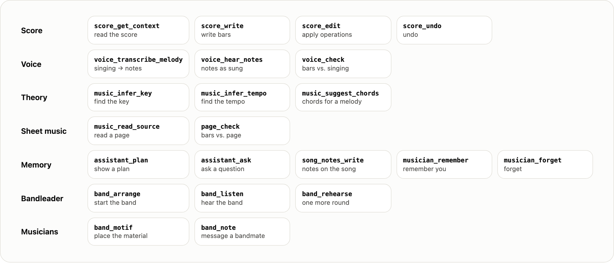

The agents act only through these tools. Each tool has a zod schema, and its description is the documentation the model reads.

## Score format

A song is stored as JSON. This is one bar of three notes:

```json
{ "id": "L0", "meter": { "numerator": 4, "denominator": 4 },
  "voices": [{ "voiceId": "voice-1", "events": [
    { "id": "L0-0", "duration": { "numerator": 1, "denominator": 1 }, "pitch": { "step": "E", "alter": -1, "octave": 4 } },
    { "id": "L0-1", "duration": { "numerator": 1, "denominator": 1 }, "pitch": { "step": "G", "alter": 0, "octave": 4 } },
    { "id": "L0-2", "duration": { "numerator": 2, "denominator": 1 }, "pitch": { "step": "C", "alter": 0, "octave": 4 } } ] }] }
```

The agents never read or write this JSON. They use **score text** instead: one line per bar, the same notation a musician would type.

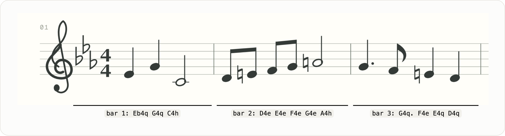

```text
bar 1: Eb4q G4q C4h
```

A note is its pitch and octave, then its length: `w` whole, `h` half, `q` quarter, `e` eighth, `s` sixteenth, with `.` for dotted. A rest is `r`, a chord is `<C4 E4 G4>`, and a slur is `( … )`. With several instruments, each line names its staff (`bar 3 cello: …`).

This piece takes 314 characters as score text and 5,346 as JSON, 17 times fewer. That leaves more of the model’s context for the music itself, and the model writes it the way musicians do.

- `score_get_context` returns score text.
- `score_write` parses score text into typed operations.
- `score_edit` takes operations directly and can point at notes by position (`2#5` is bar 2, note 5).

Every change, from the editor or from an agent, goes through one function, `applyCommand`. It checks the operation against the revision it expects, applies it to a copy, and validates the result. If anything fails, the score is unchanged and the agent gets a sentence explaining why.

## Voice input

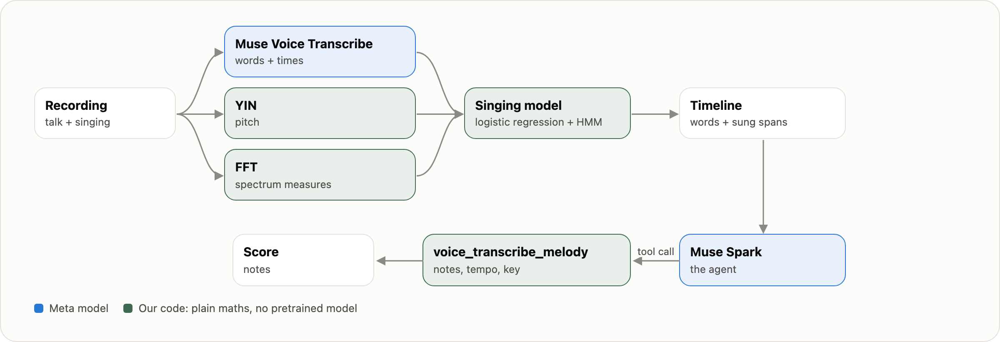

A single recording can mix talk and singing: “Put this in bar three… *da da da*… and make it swing.”

- **Words:** Muse Voice Transcribe hears the words, with their times, biased toward music terms such as BPM, Allegro and compás.
- **Pitch:** YIN, a classic pitch-detection algorithm implemented in our own code, measures the pitch every 10 ms.
- **The agent:** Muse Spark never hears audio. It reads a timeline of what was said and when something was sung, then calls `voice_transcribe_melody`.
- **Notes:** `voice_transcribe_melody` cuts the pitch track into notes and works out the tempo (following the singer’s drift) and the key.
- **Check:** `voice_check` compares the written bars with what was sung.

The app receives both the words and the audio. To tell instructions from sung parts, it combines the pitch from YIN with the spectrum of frequencies (a Fourier transform of the sound) and with where Muse Voice Transcribe did and didn’t hear words. A small model of our own uses these to label every 10 ms of the recording as talk or singing. It is plain maths (a logistic regression and a hidden Markov model) trained from scratch on recordings made for this project. No pretrained model is involved; the only models the app uses are Meta's. That labeling is what the timeline is built from, and the next two sections explain it.

### Spectrum

The first thing the model needs is a way to hear the difference between talk and singing in the sound itself. That is what the Fourier transform provides.

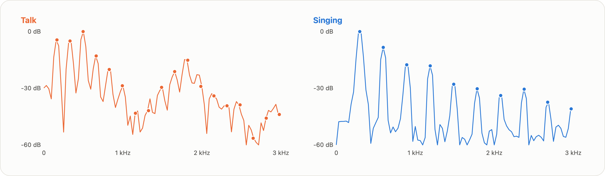

Every 10 ms, the app takes a 32 ms slice of sound, softens its edges with a Hann window, and runs a Fourier transform on it. The transform is our own radix-2 FFT in `modules/voice/domain/spectrum.ts`. The result shows how much energy the slice has at each frequency. The dots mark whole multiples of the pitch, called harmonics.

A sung vowel is a steady tone, so its energy sits on the harmonics with deep gaps in between. Talk keeps changing, and its consonants are noise, so the gaps fill in. Three measures come from the spectrum:

- **Harmonicity:** energy on the harmonics compared with energy halfway between them, in dB.
- **Spectral flux:** how much the spectrum changed since the previous slice.
- **Syllable rhythm:** a second FFT, of the loudness over one second: how much of its rise and fall happens 3 to 8 times a second, the rate of syllables in speech.

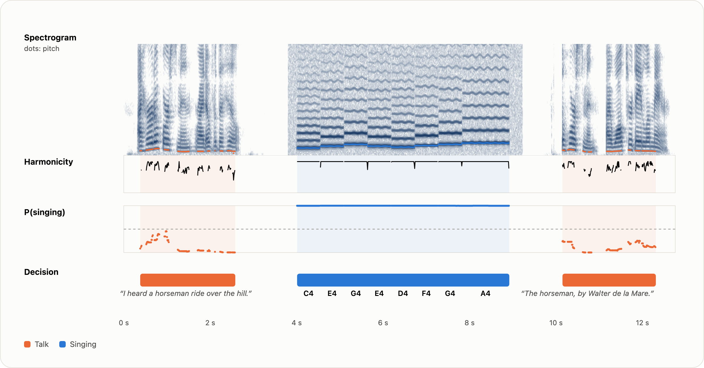

### Singing model

**Why we need it.** No single measure is reliable by itself: in the take above, harmonicity dips at every note change of the sung part, and some talk frames score high. So the model combines ten measures. Three come from the spectrum, three from YIN, and four from where Muse Voice Transcribe did and didn’t hear words.

**How it works.** Each measure gets a weight, and the weighted sum becomes the probability that the frame is singing:

$$
P(\text{singing}) = \sigma\Big(b + \sum_{i=1}^{10} w_i x_i\Big), \qquad \sigma(z) = \frac{1}{1 + e^{-z}}, \qquad b = -1.96
$$

Here $x_i$ are the ten measures (averaged over the quarter second around the frame and rescaled). A positive weight pushes toward singing, a negative one toward talk. The weights are learned from data, not set by hand:

| Measure | From | Weight |
| --- | --- | ---: |
| Harmonicity | FFT | +2.25 |
| No recognised words here (at a slow speaking rate) | Muse Voice Transcribe | +2.10 |
| The word here is a sung syllable (“da”, “la”) | Muse Voice Transcribe | +1.13 |
| No recognised words here (typical rate) | Muse Voice Transcribe | +0.61 |
| Syllable rhythm | FFT | +0.47 |
| Pitch clarity | YIN | +0.18 |
| Spectral flux | FFT | +0.03 |
| Share of time with voice | YIN | −0.20 |
| No recognised words here (fast rate) | Muse Voice Transcribe | −0.35 |
| Pitch slide between frames | YIN | −1.19 |

A frame on its own can still be wrong, so a hidden Markov model decodes the whole recording at once. It assumes that the voice rarely switches between talk and singing (3 times in 1,000 frames), so a single odd frame can’t flip the label but a sustained change can.

**Training.** The weights are found by gradient descent on the log-loss (400 steps, a small L2 penalty), and the two HMM settings by a grid search. The data is 56 recordings made for this project: 29 talk only, 8 singing only, and 19 talk then singing. Pieces of the talk-only and singing-only recordings are joined into 40 mixed takes, so the right label for every frame is known.

**Results.** Each half of the mixes is read by a model fitted on the other half, which shares no recording with it. It labels 93–98% of voice frames correctly and places 85–86% of the switches within 0.25 s. Read as whole recordings, it gets 55 of the 56 right.

**Dataset.** Everything the model was trained on is in [`datasets/singing-voice`](datasets/singing-voice/README.md): the 56 recordings, their labels, and the words Muse Voice Transcribe heard in them and in the mixes. Its README explains each step. `yarn fit:singing` reads only that folder, makes no API calls, and reproduces the weights above exactly.

## Sheet music input

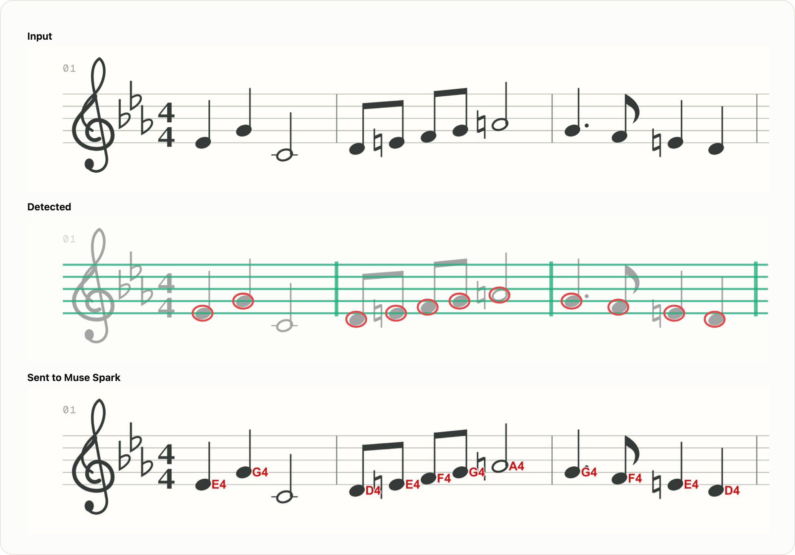

Muse Spark reads key, meter, form, chord symbols and rhythm from a picture well. It does not reliably see which line or space a notehead sits on: it is often one step off. So before Spark sees the page, a computer-vision detector measures the noteheads. It is plain image processing in `modules/page`, takes about 1 s per page, and uses no model:

1. **Staves:** rows where the ink forms five evenly spaced lines.
2. **Noteheads:** ovals on every line and space of each staff, including ledger lines.
3. **Engraving rules:** a filled head needs a stem, a whole note has none, and nothing sits inside the clef.
4. **Labels:** each head’s line or space is written next to it in red. The same heads are also listed bar by bar as text.

Spark writes the score from the labeled page. Then `page_check` compares every written bar with the detected heads and returns any differences.

In the example above, the detector missed the two half notes on a ledger line. PDFs are turned into page pictures in the browser with PDF.js.

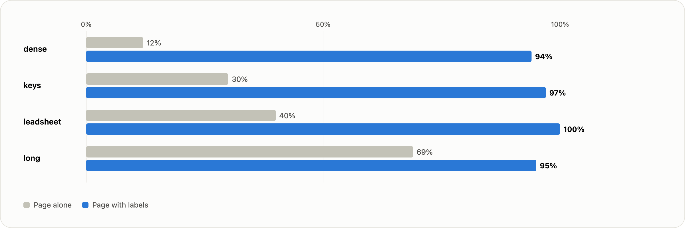

This chart shows notes read with the right pitch on four engraved test pages whose exact score is known. It uses Muse Spark 1.3 at low thinking (`yarn eval:sheet-reading`). Details: [docs/research/sheet-reading.md](docs/research/sheet-reading.md).

## Agents

### Agent loop

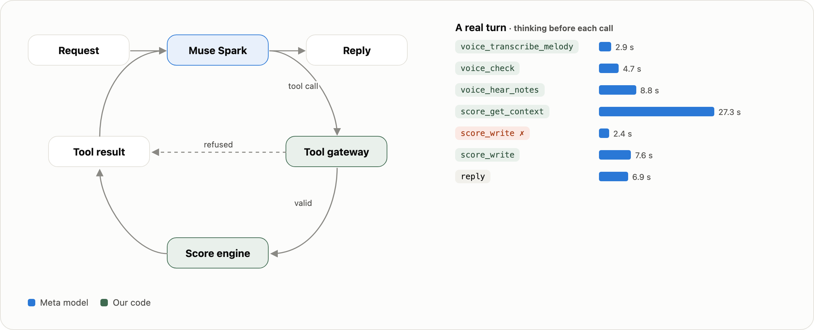

Each turn, Muse Spark receives:

- your words;
- the timeline of a recording, if there is one;
- any attached pages;
- the selection;
- the score as score text;
- the song’s notes and what it remembers about you.

It calls tools until it replies without one, up to 12 tool steps (24 when reading pages, 32 with a plan). The tool gateway turns positions into IDs and checks each call. A refused call goes back to the model as a sentence, so it can fix the call. In the real turn above, call 5 was refused and call 6 succeeded. Edits appear in the editor as they land, and the whole turn is one undo step.

### Band Mode

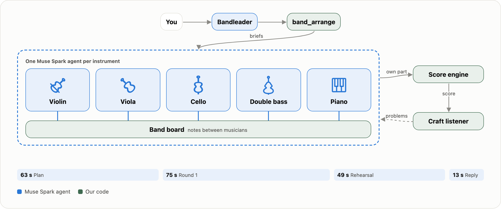

In Band Mode, the chat agent becomes the bandleader:

- **Plan.** The bandleader writes the material (a subject, hook or riff). Then it calls `band_arrange` with the style, the form, and who carries the tune where. `band_arrange` copies the tune into those parts.
- **Musicians.** `band_arrange` starts one musician agent per part. Each is its own Muse Spark conversation with its own prompt: its instrument’s craft, the style, and its role in each section. Each has five tools: `score_get_context`, `score_write`, `score_edit`, `band_motif` (places the material, moved in the key, inverted or augmented) and `band_note`. Writes outside its own staves are refused.
- **Round 1.** All musicians write at the same time, up to 3 tool steps each. They send each other notes with `band_note(to, note)`; the band board holds each note until its recipient’s next turn.
- **Craft listener.** Plain code reads the whole score and marks what a composition teacher would: parallel fifths and octaves, lines that are only scales, every part in the same rhythm, bars copied note for note, one dynamic throughout, everyone always playing.
- **Rehearsal.** All musicians again at the same time, up to 2 steps each, at low thinking. Each one reads the problems involving its part and the notes sent to it, fixes its part, and answers.
- **Reply.** `band_listen` summarises the result for the bandleader, who replies to you.

The band has a 120 s clock, plus 30 s of grace; a musician still writing when it runs out is stopped. The times in the figure are the means over 10 test pieces at medium thinking: about 3.3 minutes per piece.

Notes the musicians sent each other in one run, for “a cinematic piece for strings and piano that builds to a big climax” (verbatim, with names replaced by instruments):

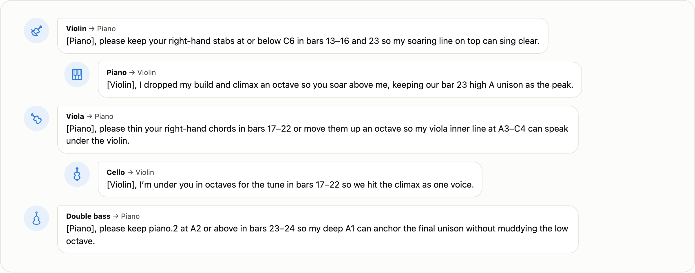

## Architecture

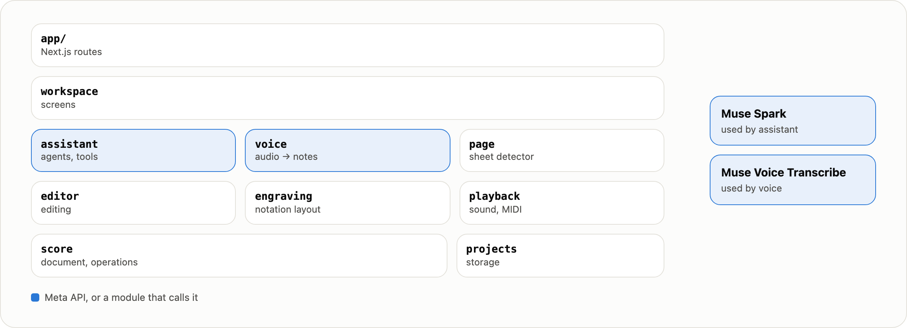

Built with Next.js 16 and TypeScript. Each module keeps its rules in plain TypeScript functions (`domain`, `application`), its adapters in `infrastructure`, and its React in `ui`. Modules import each other only through their public entry, and ESLint enforces that.

```sh
yarn check            # format, lint, typecheck, unit tests
yarn build && yarn test:e2e
yarn readme:figures   # redraws the figures in this README (README_BASE: a running app)
```

More in [docs/](docs/README.md).

## Licenses

© 2026 Daniel Oquelis. All rights reserved.

The source is public for judging the Meta Global AI Developer Hackathon. Hackathon judges and organizers may clone, install and run it to evaluate the entry. No other license to copy, modify or redistribute it is granted.

The third-party parts below keep their own licenses:

| Part | Use | License |
| --- | --- | --- |
| [Muse Spark](https://dev.meta.ai), [Muse Voice Transcribe](https://dev.meta.ai) | Agents; speech recognition | Meta AI API terms |
| [Splendid Grand Piano](https://github.com/smpldsnds/sfzinstruments-splendid-grand-piano) | Piano samples | Public domain |
| [FluidR3 GM](https://github.com/gleitz/midi-js-soundfonts) | Guitar, bass, brass, flute and string samples | CC BY 3.0 (Fluid R3: MIT) |
| [Versilian Community Sample Library](https://github.com/sgossner/VCSL) | Drum samples | CC0 1.0 |
| [Next.js](https://nextjs.org), [React](https://react.dev), [Phosphor Icons](https://phosphoricons.com), [smplr](https://github.com/danigb/smplr), [zod](https://zod.dev) | App, icons, sample playback, schemas | MIT |
| [PDF.js](https://mozilla.github.io/pdf.js/), [sharp](https://sharp.pixelplumbing.com) | PDF pages as pictures; image decoding | Apache 2.0 |
| [“The Horseman”, read for LibriVox](https://archive.org/details/spc137_1411_librivox) | The talk in the voice figures | Public domain |

Sample sources and hashes: [public/sounds/v1/CREDITS.md](public/sounds/v1/CREDITS.md).
