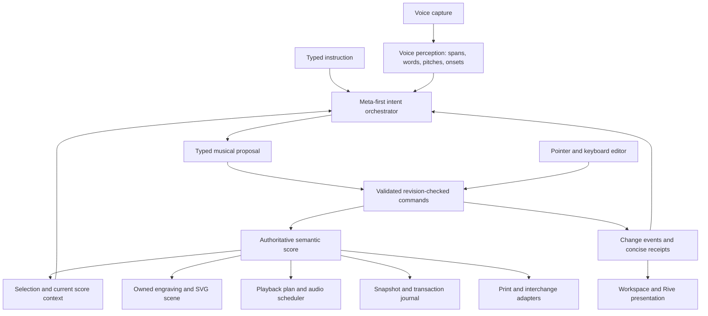

# System design

Status: proposed architecture. The product briefs govern release scope; research documents describe additional options, not additional commitments.

## Central decision

Build a modular application around a deterministic musical document and command engine. Meta models interpret intent and request tools; the application validates and executes those requests. The same document drives engraving, editing, export and playback. Audio evidence and conversation history inform it but do not replace it.



## Engines and ownership

| Boundary | Owns | Does not own |
| --- | --- | --- |
| Voice perception | Sample clock, capture quality, acoustic spans, transcript and performance evidence | Final score mutations |
| Musical interpretation | Note candidates, quantization alternatives, explicit musical constraints | Guessing away unresolved timing ambiguity |
| Agent orchestration | Context assembly, Muse Spark loop, clarification, tool budgets, proposals | Direct storage access or arbitrary execution |
| Score domain | Notes, timing, notation, constraints, revisions, transactions | React, network providers, pixel coordinates |
| Engraving | Spacing, beams, collisions, systems, glyph placement, scene and hit regions | Semantic source of truth |
| Score editor | Selection, gestures, keyboard operations, previews | Independent note storage |
| Playback | Compiling score time into sound, transport and audio scheduling | UI animation timing as musical clock |
| Workspace | Domain composition, split view, concise action history | Model-specific interpretation logic |

Perception and musical interpretation can start in one voice module with distinct internal contracts. Likewise engraving/editor/playback share score types without collapsing into one large UI component.

## Meta-first model policy

Use Muse Spark for orchestration and Muse Voice Transcribe for spoken instructions, pending real account smoke tests. Feed Spark compact structured acoustic evidence and score context. Current official documentation warns about Spark 1.3 audio quality; direct audio input should be an evaluated optional path, not the only route through the system. See the [sourced model matrix](../research/models-and-voice.md).

SAM Audio is an optional separation adapter. Clean unaccompanied voice should not require a separation call. It must improve measured note extraction before joining the main path. The hosted visual SAM API must not be mistaken for SAM Audio hosting.

Activity classification and F0/onset estimation are our own code, with no pretrained model: YIN for pitch, our FFT for the spectrum, and a logistic regression with a hidden Markov model for talk versus singing. That model is trained from scratch on [datasets/singing-voice](../../datasets/singing-voice/README.md). A pretrained pitch model (SwiftF0) was tried and removed on 2026-11-04: the only models the app uses are Meta's. No fallback should silently send recordings to a new provider.

## Runtime and deployment

Start as a modular monolith with a separate audio worker only where needed, not a collection of independently deployed domain services.

- **Browser:** microphone permission and capture, local draft UI, SVG rendering, hit testing, Web Audio playback, Rive, lightweight signal checks. Heavy local computation goes behind a worker boundary after profiling.
- **Next.js application:** session/ownership checks, project reads, bounded HTTP actions, orchestration use cases and model adapters. API keys remain server-only. Pages render domain screens; route handlers translate HTTP to application calls.
- **Audio worker:** CPU/GPU analysis that exceeds request limits; Python only if chosen inference packages require it. Versioned job contracts isolate it from TypeScript. SAM deployment is optional.
- **Realtime gateway, when needed:** durable authenticated connection for microphone frames and provider ASR, cancellation and reconnect. Do not assume a serverless Next.js route can own a long-lived WebSocket. A first complete slice may upload a finished short take and use bounded jobs; live transcription is an enhancement.
- **Persistence:** propose PostgreSQL for project snapshots, command journal and job metadata; object storage for temporary recordings. These are deployment decisions to confirm, not installed dependencies.

Client creates a capture ID and job ID. Server validates duration/size, owns provider credentials, and returns job status. Analysis results carry score revision, evidence version and run ID. Use polling initially if sufficient; introduce server events for progress when deployment supports them. Reconnecting fetches authoritative state rather than replaying assumed UI state.

## Folder design

Keep the current root `app/` and `@/*` mapping; a move to `src/` adds no architectural benefit yet. The following is a future structure, not folders already implemented:

```text
app/
  layout.tsx
  page.tsx                         # render a module-owned entry screen
  studio/[projectId]/page.tsx      # parse route context, compose screen
  api/.../route.ts                 # transport adapters only
modules/
  workspace/
    ui/components/                # WorkspaceScreen, SplitPane, ProjectHeader
    application/                  # cross-domain workflow composition
  projects/
    domain/                       # project metadata and ownership
    application/                  # open/save project, repository ports
    infrastructure/               # persistence adapters
    ui/components/                # project controls
  score/
    domain/                       # document, invariants, command reducer
    application/                  # apply transaction, undo, score queries
    infrastructure/               # snapshot/journal repository
  voice/
    domain/                       # spans, evidence, candidate contracts
    application/                  # analyze take, relabel, quantize; ports
    infrastructure/               # capture, Meta ASR, worker clients
    ui/components/                # Recorder, TakeTimeline, ModeHint
  assistant/
    domain/                       # musical intents, run/proposal states
    application/                  # orchestrator and tool registry
    infrastructure/               # Muse Spark adapter
    ui/components/                # IntentCard, Clarification, Composer
  engraving/
    domain/                       # layout stages, glyph metrics, scene
    infrastructure/               # glyph/font and export adapters
    ui/components/                # ScoreSurface and overlays
  editor/
    application/                  # gesture-to-command, selection context
    ui/components/                # Inspector, NotationToolbar
  playback/
    domain/                       # playback plan and tempo conversion
    application/                  # transport use cases
    infrastructure/               # Web Audio and sound assets
    ui/components/                # Transport
  motion/
    ui/components/                # Rive adapter and static fallback
shared/
  ui/                             # domain-free buttons, dialogs, tokens
  contracts/                      # genuinely cross-boundary primitives
  infrastructure/                 # config/logging, not business rules
composition/                      # browser/server dependency assembly
workers/audio/                    # only if chosen model needs service
public/motion/                    # authored Rive assets and contracts
docs/
```

Use only the layers a module needs. Do not create empty architecture boilerplate. Domain code has no imports from Next.js, React, Rive, a database or a model SDK. Application code depends on domain and declared ports. Infrastructure implements those ports. UI calls application facades; modules expose small public APIs, not imports into each other's internals. Score types are shared through the score public API, not duplicated in each engine. Keep browser and server entrypoints separate to prevent credentials or Node-only libraries entering client bundles.

The installed Next.js documentation supports keeping interactive/browser APIs at Client Component boundaries and server secrets on the server. Consult the bundled guides again before coding specific framework features; do not infer APIs from an older Next.js version.

## State, persistence and recovery

The persisted score snapshot and its monotonically increasing revision are authoritative. UI may show a pending local command immediately, but distinguish pending from acknowledged state. Server atomically validates expected revision, writes the new snapshot and transaction, then acknowledges. Idempotency prevents retry duplication. Single-writer ordering per score is sufficient initially; no CRDT is required.

Do not initiate a score-changing agent run against unacknowledged local edits. Flush or explicitly include pending work and await its revision first. A failed save remains visible; keep a recoverable local draft if implemented, with a clear conflict on reopen. Never claim offline persistence until tested.

Store immutable take evidence separately from editable score data. Reanalysis produces new candidates, not silent edits. Cancel/supersede old runs on new intent; late results must match an active run and current revision before being offered. A project deletion must cascade through evidence references, pending jobs and temporary assets.

## Boundaries and observability

Authorize project access on every query, mutation and audio job. Bind tools to the current project server-side. Treat transcripts, annotations and model outputs as untrusted inputs; annotation text cannot redefine tool permissions. Allowlist musical operations, validate schemas and ranges, and cap operation counts, tool steps, duration, bytes and inference cost per run.

Proposed initial loop cap: eight tool steps and one active mutating run per project; timeout and cost budgets should be chosen after provider measurements. Retries reuse request IDs. Expensive analysis jobs have bounded retries and cancellation.

Proposed privacy default: do not retain raw voice after analysis/retry window (maximum 24 hours), unless the user explicitly saves a take. Confirm provider retention, region and deletion behavior before a pilot. Preserve non-audio provenance without claiming the raw evidence is still available. Logs contain run IDs, stages, timings, versions and failure categories; exclude raw audio/transcripts by default.

Track capture-to-proposal latency, note correction burden, stale conflicts, schema rejection, failed saves, provider cost and model version. Tool receipts are concise product output; operational traces remain a separate diagnostic surface.
