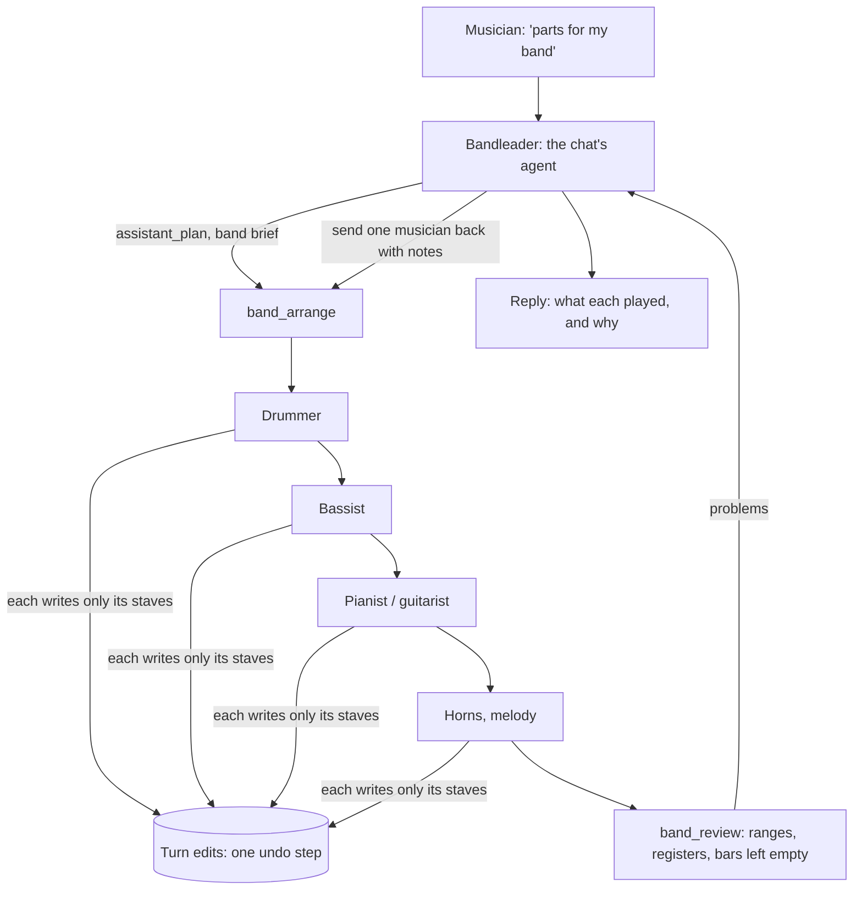

# Band agents plan

Status: planned on 1 November 2026, not started. Hackathon deadline: Thursday 5 November, 03:00 CET.

## Goal

When the musician asks for a band arrangement ("parts for my band", "arrange this for piano, bass, trumpet and drums"), the parts are written by one agent per instrument, the way a band builds a song in rehearsal, with the chat's agent as the bandleader. Small requests (a chord, a note, a take) stay with the single agent as today.

Three problems we have already seen, each with an answer here:

| Seen | Answer |
| --- | --- |
| One agent writes every part in one edit, from one long prompt: thin instrument craft (a trombone for a walking bass, slashes put on the wrong staff) | Each musician has a short brief about its own instrument only: range, clef, transposition, how its notation works, its idioms |
| Parts written at once do not hear each other | Musicians play in rehearsal order and each reads the score so far: drums, then bass (locking to the kick), then harmony (out of the bass's and the melody's way), then horns |
| An edit meant for one part lands on another | Each musician may write only its own staves, checked in code |

## How a request runs

1. **The bandleader** (the existing agent) reads the request and the song notes, shows its plan, and calls `band_arrange` with a band brief: feel and style, form, what each instrument should do, and who carries the melody.
2. **`band_arrange`** adds the parts that are missing and then runs one musician per part, in rehearsal order: drums → bass → harmony (piano, guitar) → horns and melody. The order is decided in code from each instrument's role. The bandleader may override it.
3. **A musician** is a short agent loop (Muse Spark, its own system prompt, at most 6 steps):
   - It reads the whole score and the reports of those who played before it.
   - It writes its part with `score_write` or `score_edit`, scoped to its own staves.
   - It replies to the bandleader in one or two sentences ("roots on 1, walking up to each chord change; kept above E1").
4. **`band_review`** is deterministic and costs no model call. It reports notes outside each instrument's range, bars a part left empty, a harmony part sitting in the melody's register, and parts whose bar count differs.
5. **The bandleader** sends a musician back with notes if needed (`band_arrange` for that part only), then replies with what each played.

All of it runs inside one turn: the same `TurnEdits` ledger, one undo step, the same replay check. The musicians' edits go through the same gateway as everything else.

## Pieces

| Piece | Where | What |
| --- | --- | --- |
| Instrument craft cards | `assistant/application/musicians.ts` | For each instrument: role (`groove`, `bass`, `harmony`, `lead`), rehearsal order, and a short brief: range (from `INSTRUMENTS`), clef and transposition, notation conventions (drum voices: hands up, feet down; `putGroove` and the groove names for each meter; bass written an octave up; piano two staves), and idioms. Facts the tools cannot carry |
| Musician loop | `assistant/application/run-musician.ts` | A small loop over the same `ModelPort`: its own system prompt (craft card + band brief + "write only your part, then report"), the score context, the previous musicians' reports, and the musician memory facts. Tools: `score_get_context`, `score_write`, `score_edit`. Step cap 6; thinking from the request's level, one step lower for musicians |
| Staff scope guard | `assistant/application/part-scope.ts` | An operation from a musician may touch only that part's staves and voices (like the heard-notes guard): `addPart`, `setKey`, `setMeter`, other parts' bars are refused with a reason |
| `band_arrange` / `band_review` tools | `assistant/application/band-tools.ts` | Specs and schemas (`parts: [{ part or instrument, brief }]`, `feel`); `band_arrange` runs the musicians and returns their reports; `band_review` returns problems by part and bar |
| Progress | `ProgressEvent` | `{ stage: "musician", part, state: "waiting" \| "playing" \| "done", text? }`; a musician's thoughts stream as its own events |
| Band room | `assistant/ui/components/BandRoom.tsx` | In the working turn: one row per musician (instrument icon, name, state, its latest thought in one line, sliding in like `LiveThought`); folded into the turn's summary when done |

The bandleader's prompt gains one line: for an arrangement of several parts, plan, then `band_arrange`, then `band_review`, then reply. That line needs a case in the prompt-rules eval.

## Evaluation: does it beat one agent?

Before showing it as better, compare on the same requests:

- **Requests:** "parts for piano, bass, trumpet and drums" on the lead-sheet fixture, on the D-minor waltz, and on a sung melody with chords.
- **Runs:** each twice with the single agent and twice with the band.
- **Measured without a model:** notes out of range; harmony in the melody's register (piano voicing tops above the melody's lowest note); the bass's note on beat 1 being the chord's root; empty or half-filled bars; parts that differ in bar count; seconds and tokens.
- **Listened to:** by the owner, blind if possible.
- **Script:** `scripts/band-eval.mts`, like `api-compare.mts`. Paid: about $2–4.

If the band is not clearly better on quality, it stays as a demo of the agent workflow, but behind a setting rather than the default for arrangements.

## Risks and cutlines

- **Time per arrangement:** 4 musicians × up to 6 steps. Expect 1.5–3 minutes, against about 70 s today. Mitigation: musicians think one level lower than the bandleader; the drums need no model when a named groove fits (`putGroove` straight from the brief).
- **A musician misreads the brief:** the review and one round of notes catch most of it. More than one round is out of scope.
- **Parallel musicians:** out of scope. Rehearsal order is the point: each hears the others.
- **Model choice:** Meta's agent guide suggests Muse Wonder for a main loop and Spark for sub-agents. We keep Spark for both (Wonder measured no better on page reading at about 4× the price) and say so in the submission.

## Order of work

1. Craft cards, the scope guard and the musician loop, with scripted-model unit tests: a musician writes its part, a musician touching another part is refused, the order is drums → bass → harmony → horns, and the turn is one undo step.
2. `band_arrange` and `band_review`, the progress events and the bandleader's prompt line.
3. The band room in the chat.
4. Real runs, prompt tuning, the A/B evaluation.
5. Freeze for the demo.
