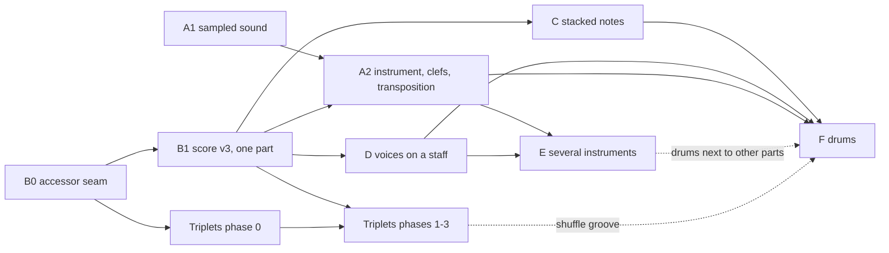

# Instruments, voices and ensembles plan

Status: phases A1 (sampled piano), B0 (accessor seam), triplets phase 0 (note lengths) B1 (score v3, one part), A2 (choosing the instrument) and D (two voices on a staff) implemented; C, E and F planned. Written 29 October 2026 against commit `5799adf` (main). The document is self-contained. A session implementing it needs only the repository, `AGENTS.md`, [code conventions](../architecture/code-conventions.md) and this plan. Read the [triplets plan](triplets-plan.md) too, because the two plans touch the same code.

## Goal

What the musician asked for, in their words:

1. **Real instrument sound** instead of the "poor MIDI" sound. Piano is the default, with guitar, trumpet, flute, trombone and drums also available.
2. **Several independent lines on one staff**, "each line following independent bar rules". For example, a guitar's thumb (bass) against its fingers (melody).
3. **Several instruments at once**: a group of staves.
4. **Drums.**

Each capability must work in the editor and as an agent tool. Each one goes through `applyCommand`, renders with our own SVG engine and plays back.

## Verified starting point

| Area | Fact (file, function) |
| --- | --- |
| Package manager | Yarn 4.14.1 with `node_modules` (`package.json` `packageManager`). Runtime dependencies are `next 16.4.3`, `react 19.3`, `zod 4`, `onnxruntime-node` and `@phosphor-icons/react`. There is no audio library. |
| Network / CSP | `next.config.ts` sets no `headers()`, CSP or `images`. There is no `proxy.ts` or `middleware.ts`. `public/` holds only starter SVGs. Nothing blocks self-hosted audio or a CDN today. |
| Sound | `modules/playback/infrastructure/audio-player.ts` `AudioPlayer` builds one triangle `OscillatorNode` per note (`scheduleTone`) and sine pads for chord symbols (`scheduleChord`). It schedules the whole score up front ("Bounded to 32 short measures"). `audition(frequency)` plays a single note. |
| Plan | `modules/playback/domain/plan.ts` `createPlaybackPlan(score, fromMeasureId)` gives `PlaybackEvent { id, beat, beats, start, duration, frequency, gain, gate, tiedTo }` plus `ChordSound[]`. Dynamics map to `DYNAMIC_GAIN`. Ties are handled by `joinTies`, repeats by `performance-order.ts` `performanceOrder` and `soundingSource`, chord symbols by `chord-track.ts` `voiceChord`. The file is 178 lines. |
| Score | `modules/score/domain/schema.ts` uses `schemaVersion: 2`. It has `measures[]` with `{ id, meter, events[], tempo?, style?, section?, width? }`. There is one global `key`, one `tempo`, and `annotations` / `repeats` / `chords` / `marks` / `slurs` that reference measure or event IDs. `pitchSchema` octave is limited by `OCTAVE_RANGE = {3..6}` (`pitch.ts`). There is no instrument or clef field. |
| Load and migrate | `modules/score/domain/validation.ts` `parseScore` runs `migrateVersion1` and then `convertLegacyGaps`. It is called by `projects/infrastructure/local-project.ts` (localStorage key `amanuensis.score.v1`, unchanged since v1), by `assistant/application/handle-request.ts` and `handle-voice-request.ts` (the score the browser sends), and by `applyCommand`. The engraving fixtures load through it in unit and e2e tests. |
| After each command | `apply-command.ts` `applyCommand` runs `pruneTies`, then `respellScore`, then `pruneSlurs`, increments the revision, and finishes with `parseScore`. |
| Ties / slurs | `ties.ts` `allEvents` and `slurs.ts` `eventOrder` flatten every bar's `events` into one "score order" list. |
| Agent view | `score/application/score-text.ts` `scoreText` and `SCORE_TEXT_GUIDE` (the guide is embedded in `assistant/application/system-prompt.ts`). Writing goes through `score-text-write.ts` `parseBarsText` / `writeBars`. Addresses go through `positions.ts` `resolvePositions` ("2#3", "2:3", "2") and `notation-positions.ts` (`notationAt`, `positionOf`). |
| Engraving | The pipeline is `engraving/domain/layout-score.ts` `layoutScore` → `measure-analysis.ts` `analyzeScore` (the treble `BOTTOM_LINE = E4` is hard-coded, stems by `groupStemsDown`) → `line-breaking.ts` `breakLines` → `layout-system.ts` `layoutSystem` → `place-bar.ts` `placeBar` → `beams.ts` `beamBar` → `above-staff.ts` → `labels.ts` → `ties.ts` `placeTies` / `slurs.ts` `placeSlurs`. In `scene.ts`, a `System` has a single `top`, and `SYSTEM_HEIGHT = 230` is fixed. `header.ts` holds treble-only `SHARP_POSITIONS` / `FLAT_POSITIONS`. `StaffGlyphs.tsx` has only `TrebleClef`. |
| Editor | `editor/ui/components/surface/ScoreSurface.tsx` runs `layoutScore` on every render. Its SVG `aria-label` contains "treble clef", and the e2e tests locate the sheet by that text. `SheetEvent.tsx` labels read "Bar 1, beat 1, C4, 1 beats" and are matched exactly by `tests/e2e/workspace.spec.ts`. Note editing is in `editor/application/note-edits.ts`, selection in `selection.ts` and `sheet-selection.ts`, and the card in `selection/NoteActions.tsx`. |
| Voice | The assistant tool `voice_transcribe_melody` (`assistant/application/voice-transcription-tool.ts` `transcribeIntoScore`) writes `replaceMeasure` batches. `heard-bars-guard.ts` protects transcribed bars by measure ID. |
| Sound test | `tests/e2e/workspace.spec.ts` "a note sounds when pressed…" patches `OscillatorNode.prototype.start` to record frequencies. |
| Limits | `SCORE_LIMITS` allows 32 measures and 32 events per measure. `OPERATION_BATCH_LIMIT = 256`. `MAX_REQUEST_BYTES = 1_000_000` (`handle-request.ts`). ESLint `max-lines` is 200, with blank lines and comments skipped and tests exempt. |

### Direct reads of `measure.events` (the refactor inventory)

Found with `grep -rn "\.events\b" modules app scripts`. There are about 90 reads in 37 files. Every one of them goes through the accessor seam in phase B0.

| Module | Files (count) | What they do |
| --- | --- | --- |
| score/domain | `validation.ts` (4), `queries.ts` (3: `findEvent`, `anchorIds`), `ties.ts` (1: `allEvents`), `slurs.ts` (2: `eventOrder`, `slurEnds`), `respell.ts` (4), `lead-sheet-validation.ts` (1: `validateBarMarks`), `harmonize.ts` (1: melody slots) | validation, score order, respelling, harmony |
| score/domain/operations | `meter-operations.ts` (8), `measure-operations.ts` (6), `event-operations.ts` (2), `lead-sheet-operations.ts` (2), `rests.ts` (1: `onsetOf`), plus `draft.ts` `fullMeasureRest` (constructs events) | mutations |
| score/application | `notation-positions.ts` (4), `positions.ts` (2), `describe-score.ts` (2), `score-text.ts` (1) | agent view and addresses |
| playback | `plan.ts` (3), `audio-player.ts` (2, through the plan), and `performance-order.ts` / `chord-track.ts`, which read `measure.style` | sound |
| engraving | `spacing.ts` (3), `place-bar.ts` (3), `layout-system.ts` (3), `measure-analysis.ts` (2), `slurs.ts` (2), `ties.ts` (1), `labels.ts` (1), `above-staff.ts` (1) | layout |
| editor | `gesture-preview.ts` (6), `selection.ts` (5), `sheet-selection.ts` (2), `range-edits.ts` (2), `note-edits.ts` (1), `use-sheet-gestures.ts` (2), `ScoreSurface.tsx` (1), `SheetSystem.tsx` (1) | selection and gestures |
| assistant | `voice-transcription-tool.ts` (1: `lastBarWithNotes`), `heard-bars-guard.ts` (through `findEvent`), `harmony-tool.ts`, `score-tool-gateway.ts` (`anchorIds(score.measures)`) | tools |
| scripts | `score-format-experiment.mts` (4), `assistant-smoke.mts` (1), `lib/takes.mts` (1) | experiments |
| tests | many direct `score.measures[i].events[j]` reads (`agent-tools.test.ts`, `score.test.ts`, …) | assertions |

`event.pitch` truthiness is used as "is a note" in about 80 places (`grep -rn "\.pitch\b" modules`). Drums (phase F) would add notes with no pitch, so phase B0 also introduces `isNote` / `isRest` (see below).

## Decisions that span all phases

| Decision | Chosen | Rejected, and why |
| --- | --- | --- |
| Sound engine | **`smplr` 1.1.0** (MIT, no dependencies, about 1 MB unpacked). It provides `start({ note, velocity, time, duration })` on the audio clock, a `notesToLoad` subset, `baseUrl` / `instrumentUrl` for self-hosting, `Sampler` with named buffers for drums, `volume` / `pan` per instrument, and `ready`. | **Tone.js + Sampler**: a larger dependency, its own transport and clock to reconcile with ours, and no sample sets included. **Our own AudioBuffer sampler**: re-implements velocity layers, release and nearest-sample repitching that smplr already handles. **Web MIDI / SoundFont2 player**: loading `.sf2` means 148 MB+ files. |
| Where samples come from | **Self-hosted under `public/sounds/v1/`**. A reproducible `yarn sounds:fetch` script fills it, and it ships with a `manifest.json` and `CREDITS.md`. | **Loading from the GitHub Pages CDN at runtime** (smplr's default). smplr's own README warns that this hosting rate-limits. It adds a third-party dependency at play time, makes e2e tests depend on the network, and leaks usage. The licenses below allow redistribution, so we host the files ourselves. |
| Pitch storage for transposing instruments | **Concert (sounding) pitch** is stored, and score text shows concert pitch. Only engraving shows written pitch (with a "Concert pitch" view toggle). | **Written pitch stored**: playback, harmony analysis (`harmonize.ts`), chord symbols, the transcriber (which hears concert pitch) and cross-part reasoning would all need transposing on every read, and changing a part's instrument would rewrite its notes. Concert storage is what Dorico and MuseScore present by default. |
| Out-of-range notes | **Soft.** An instrument has a playable range. Notes outside it are allowed, drawn in a warning colour, listed in score text and played. The hard limit is the pitch schema: A0–C8. | **Rejecting** would make `setInstrument` fail on existing music and block sketching. |
| Score shape | **v3, bar-major**: `measure.voices[]` holds one `VoiceBar` per voice, and `score.parts[]` declares parts → staves → voices. It is designed once for parts, staves, voices, tuplets, stacked notes and drums. | **Part-major** (MusicXML partwise, `part.measures[]`): every bar operation (`appendMeasure`, `deleteMeasure`, `setMeter`, `duplicateMeasure`) would have to touch N parallel arrays and keep them aligned. Bar-major keeps one bar as one atomic object. |
| Global vs local | Global: meter per bar, key (concert), tempo and tempo changes, repeats, marks, sections, chord symbols, bar width. Per part: instrument, name, mixer, staves. Per staff: clef and slash/repeat style. Per voice: events, ties, slurs. | Per-part meters (polymeter) and per-part keys are out of scope. A transposing part's written key is derived. |
| Additive fields | New **optional** fields (`tuplet`, `stack`, `drums`, more instrument ids) do not bump `schemaVersion`. This follows the v2 precedent for `chords` / `marks` / `slurs` with `.default([])`. | A version bump per feature. |

## Research: instrument sounds

Verified on 29 October 2026 with HEAD requests and the repositories' READMEs.

| Source | What | License | Size (measured) | Self-host |
| --- | --- | --- | --- | --- |
| **Splendid Grand Piano** (`smpldsnds/sfzinstruments-splendid-grand-piano`, smplr `SplendidGrandPiano`) | Steinway, AKAI, 4–5 velocity layers, 226 samples per format | **Public domain** (released by AKAI; listed as Public Domain by sfzinstruments) | about 19.9 MB `.ogg` (Opus) and about 23.8 MB `.m4a` (AAC) for the full set | yes: `baseUrl` |
| **FluidR3_GM** via `gleitz/midi-js-soundfonts` (smplr `Soundfont`, `kit: "FluidR3_GM"`) | GM instruments as base64 `-mp3.js`, one file per instrument, 88 notes | gleitz states **CC BY 3.0**. Upstream Fluid R3 by Frank Wen is **MIT** (Debian copyright). Either way, attribution satisfies it. | `acoustic_guitar_nylon` 1.84 MB, `acoustic_guitar_steel` 1.98 MB, `trumpet` 2.94 MB, `flute` 2.97 MB, `trombone` 2.62 MB, `acoustic_grand_piano` 2.63 MB | yes: `instrumentUrl`. CORS is `*`. |
| MusyngKite (same repository) | Heavier, nicer GM set | **CC BY-SA 3.0** | about 2–2.9 MB per instrument | yes |
| `tonejs-instruments` | 19 instruments (no drums), mp3/ogg per note | code MIT, samples "CC-BY 3.0" from "various public domain sources" | not stated | yes |
| Salamander Grand Piano | Yamaha C5, 16 velocity layers | CC BY 3.0 (Alexander Holm) | 394 MB+ | yes |
| **VCSL** (`sgossner/VCSL`, converted to ogg/m4a at `smpldsnds/sgossner-vcsl`) | Kick (Bass Drum 1–3), snares (Modern 1–3, with round-robins), toms, Hi-Hat Cymbal (closed, open, loose, hit layers), suspended and clash cymbals, plus a Steinway B and Kawai grand | **CC0 1.0** | the full library is about 680 MB+. One-shots are 40–1000 KB each as WAV, smaller as Opus. | yes |
| smplr `DrumMachine` (`smpldsnds/drum-machines`) | TR-808, LM-2, Casio RZ-1 and others | README: "public domain samples". There is no LICENSE file. | small | yes |
| DrumGizmo DRS / Muldjord kits | Acoustic multi-mic kits | CC BY 4.0 | 347–754 MB | needs a mixdown |
| Salamander Drumkit | Acoustic kit | CC BY-SA 3.0 | about 370 MB | yes |

There is no GM drum kit (channel 10) in `midi-js-soundfonts`: `FluidR3_GM/percussion-mp3.js` returns 404.

**Recommendation:**

- **Piano**: Splendid Grand Piano (public domain). Load it through `SplendidGrandPiano` with a self-hosted subset of two velocity layers (soft and loud) on every sample root, Opus plus AAC. That is about 8 MB, and the budget is enforced by a test. Use `notesToLoad` (with `fallback: "nearest"`) so only the roots around the score's notes are decoded.
- **Guitar, trumpet, flute, trombone**: FluidR3_GM `-mp3.js` through `Soundfont` with `instrumentUrl`. It is attribution-only and about 2–3 MB each. MusyngKite sounds better, but CC BY-SA would attach share-alike terms to the copies we redistribute, so leave it out. Leave `tonejs-instruments` out too: its sample provenance is not documented per file.
- **Drums**: our own small kit from VCSL CC0 one-shots (kick, snare, side stick, three toms, hi-hat closed / open / foot, crash, ride, ride bell). Take the Opus and AAC files from the `smpldsnds/sgossner-vcsl` mirror, so no ffmpeg is needed. Load them through smplr `Sampler` with a named `buffers` map. VCSL's cymbals are orchestral, so the product owner should listen. The fallback is a DrumGizmo kit (CC BY 4.0) mixed down by a script.
- **Format note**: Playwright's bundled Chromium has no proprietary codecs (AAC). Serve Opus/ogg as well as m4a, because smplr picks the format the browser can play.
- **Attribution**: `public/sounds/v1/CREDITS.md` lists each source, author, license and URL. A "Sounds" credit line goes in the app (see open questions). Add a research note, `docs/research/instrument-sounds.md`, containing this table.

Sources: [smplr README](https://github.com/danigb/smplr), [gleitz/midi-js-soundfonts](https://github.com/gleitz/midi-js-soundfonts), [sfzinstruments pianos](https://sfzinstruments.github.io/pianos), [sfzinstruments drums](https://sfzinstruments.github.io/drums), [Splendid Grand Piano mirror](https://github.com/smpldsnds/sfzinstruments-splendid-grand-piano), [VCSL](https://github.com/sgossner/VCSL), [VCSL ogg/m4a mirror](https://github.com/smpldsnds/sgossner-vcsl), [tonejs-instruments](https://github.com/nbrosowsky/tonejs-instruments), [drum-machines](https://github.com/smpldsnds/drum-machines), [Fluid R3 license (Debian)](https://sources.debian.org/copyright/license/fluidr3mono-gm-soundfont/2.315-7), [Salamander Grand Piano](https://github.com/sfzinstruments/SalamanderGrandPiano).

## Score shape v3 (designed once)

```ts
// modules/score/domain/schema.ts, v3 (schema-only names; the instrument catalog lives in instruments.ts)
export const SCORE_LIMITS = {
  measures: 32,
  eventsPerMeasure: 32, // per voice bar
  events: 4096, // all voices together: keeps the request under MAX_REQUEST_BYTES
  parts: 8,
  stavesPerPart: 2,
  voicesPerStaff: 4, // the editor offers 2; engraving handles 1–4 (odd up, even down)
  annotations: 256,
  repeats: 16,
  chords: 256,
  marks: 64,
  slurs: 256,
};

export const CLEFS = ["treble", "bass", "treble8vb", "percussion"] as const;

const voiceSchema = z.strictObject({ id: idSchema });
export const staffSchema = z.strictObject({
  id: idSchema,
  clef: z.enum(CLEFS),
  voices: z.array(voiceSchema).min(1).max(SCORE_LIMITS.voicesPerStaff),
});
export const partSchema = z.strictObject({
  id: idSchema,
  instrument: z.enum(INSTRUMENT_IDS), // B1: ["piano"]; A2 adds guitar, trumpet, flute, trombone; F adds drums
  name: z.string().trim().min(1).max(40),
  abbreviation: z.string().trim().min(1).max(12).optional(),
  staves: z.array(staffSchema).min(1).max(SCORE_LIMITS.stavesPerPart),
  volume: z.number().min(0).max(1).multipleOf(0.05).optional(), // mixer; default 0.8
  muted: z.literal(true).optional(),
});
export const voiceBarSchema = z.strictObject({
  voiceId: idSchema,
  events: z.array(eventSchema).min(1).max(SCORE_LIMITS.eventsPerMeasure),
  /** Was measure.style in v2: a staff shows slashes or a repeat sign. Only on a staff's first voice. */
  style: z.enum(["slashes", "repeat"]).optional(),
});
const measureSchema = z.strictObject({
  id: idSchema,
  meter: meterSchema,
  width: z.number().min(MEASURE_WIDTH.min).max(MEASURE_WIDTH.max).optional(),
  tempo: tempoSchema.optional(),
  section: z.string().trim().min(1).max(SECTION_LABEL_MAX).optional(),
  voices: z.array(voiceBarSchema).min(1),
});
// annotationSchema gains: staffId: idSchema.optional()
// eventSchema is unchanged in B1. Later additive, optional fields:
//   tuplet  (triplets plan)     { id, actual: 3, normal: 2 }
//   stack   (phase C)           Pitch[]: further notes on the same stem, above `pitch`
//   drums   (phase F)           DrumPiece[]: unpitched hits; `pitch` stays null
export const scoreSchema = z.strictObject({
  schemaVersion: z.literal(3),
  id, revision, title, tempo, key, // unchanged; key is concert pitch
  parts: z.array(partSchema).min(1).max(SCORE_LIMITS.parts),
  measures: z.array(measureSchema).min(1).max(SCORE_LIMITS.measures),
  annotations, repeats, chords, marks, slurs, // unchanged shapes
});
```

**Invariants** (new `modules/score/domain/structure-validation.ts`, called from `parseScore`):

1. Part, staff and voice IDs are registered in the same `IdRegistry` as everything else.
2. `measure.voices` lists voice bars in declaration order: part order, then staff order, then voice order. There is at most one bar per voice.
3. **Each staff's first voice has a bar in every measure** (these are the primary voices). Other voices are optional per bar; an absent bar means that voice is silent and not drawn there. `measure.voices[0]` is therefore always the score's primary voice: first part, first staff, first voice.
4. Every voice bar is complete. `validateMeasure`'s capacity check runs **per voice bar**, which is what "each line following independent bar rules" means. Triplet groups (from the triplets plan) are validated per voice bar.
5. `style` only appears on a staff's first voice, only when that staff has no other voice bar in that measure, and only over a whole-bar rest. `validateBarMarks` moves to a per-staff check.
6. A tie joins an event to the **next event of the same voice**. This crosses a barline only when that voice has a bar in the next measure.
7. A slur's ends are in the **same voice**. Overlap is checked per voice.
8. An annotation anchored to an event takes that event's staff. An annotation anchored to a measure needs a `staffId` when it is a dynamic; for text it is optional, and absence means it sits above the system.
9. Clef `percussion` is used if and only if the part's instrument is `drums`.
10. The total number of events is at most `SCORE_LIMITS.events`.

**Migration v2 → v3** (new `modules/score/domain/migrations.ts`, which takes over `migrateVersion1` and `convertLegacyGaps` from `validation.ts` so that file stays under 200 lines). The chain is v1 → v2 → v3:

- Add `parts: [{ id: P, instrument: "piano", name: "Piano", staves: [{ id: S, clef: "treble", voices: [{ id: V }] }] }]`. `P`, `S` and `V` are `part-1`, `staff-1` and `voice-1`. A helper `freeId(base, taken)` appends `-2`, `-3`… if a file already uses that ID.
- Each measure `{ events, style, ...rest }` becomes `{ ...rest, voices: [{ voiceId: V, events, ...(style ? { style } : {}) }] }`.
- Dynamics anchored to a measure get `staffId: S`.
- Revision, title and every other ID stay unchanged. The storage key `amanuensis.score.v1` stays. The browser saves v3 from the next edit on. The `tests/fixtures/engraving/*.json` files **stay v2 on purpose**, so every test run exercises the migration.

**IDs created by operations** keep the `${idPrefix}-…` scheme: `-part`, `-staff`, `-voice`, and `-v${k}n${i}` for events of voice bars beyond the first in `duplicateMeasure`.

### The accessor seam (phase B0, used by all later phases)

New file `modules/score/domain/voice-access.ts`, exported from `modules/score/index.ts`:

| Function | B0 (v2 shape) | B1 (v3 shape) |
| --- | --- | --- |
| `voiceBars(measure): VoiceBar[]` | `[{ voiceId: PRIMARY_VOICE, events: measure.events, style }]` | `measure.voices` |
| `barEvents(measure, voiceId?)` | `measure.events` | events of that voice bar (primary when omitted) |
| `setBarEvents(measure, events, voiceId?)` | writes `measure.events` | writes or creates the voice bar |
| `barStyle(measure, staffId?)` | `measure.style` | first voice bar of that staff |
| `voiceEvents(score, voiceId)` | all events in order | one voice, bar by bar (ties, slurs, ranges) |
| `everyEvent(score)` | all events | all voices (anchors, IDs, totals) |
| `findEvent` / `locateEvent` (in `queries.ts`) | adds `voiceId` | adds `voiceId`, `staffId`, `partId`, `voiceBar` |
| `voiceInfo(score, voiceId)` | constant | `{ part, staff, voice, voiceIndex, staffIndex }` |
| `isNote(event)` / `isRest(event)` | `event.pitch !== null` | phase F: `\|\| !!event.drums?.length` |
| `primaryVoiceId(score)` | constant | `score.parts[0].staves[0].voices[0].id` |

Rule from B0 on: **no code outside `voice-access.ts`, `migrations.ts` and the schema reads `measure.events` or `measure.style`**. Enforce it with an ESLint `no-restricted-syntax` selector on `MemberExpression[property.name='events']` in `modules/**`, with an exception list. Scene objects such as `system.events` and `bar.events` from engraving are a different type; the selector is scoped to score data. If that proves too blunt, put the check in a unit test that greps.

---

## Phases

Every phase leaves the app working, with `yarn check` passing and then `yarn build && yarn test:e2e` passing. The letter C was not in the brief. It is used here for **stacked notes on one stem**, which guitar, piano and drums all need. "T" means the triplets plan.

### Phase A1: sampled sound (no schema change)

**Goal.** Every note plays with a sampled piano. Chord symbols play as soft piano. The oscillator stays only as a fallback.

**Scope.** Playback infrastructure, the sound files, loading state and the e2e sound probe. There are no instruments yet: piano is hard-wired.

**Decisions.**

- **The plan speaks MIDI and velocity.** `PlaybackEvent` loses `frequency` and gains `notes: number[]` (MIDI; empty means silence) and `velocity: number` (1–127). `gain` is kept only for the reference tone. Dynamics map through `DYNAMIC_VELOCITY = { pp: 33, p: 49, mp: 64, mf: 80, f: 96, ff: 112 }`, and an accent adds `ACCENT_VELOCITY = 16`, capped at 127. `notes` is an array so that stacked notes (C) need no reshaping later.
  - Rejected: keeping frequencies, because samplers are keyed by MIDI.
- **A port between transport and sound.** New `modules/playback/application/sound-port.ts`:

  ```ts
  type SoundRequest = { instrument: SoundId; midi: number; time: number; duration: number; velocity: number };
  interface SoundOutput {
    prepare(instruments: SoundId[], midis: number[]): Promise<void>;
    play(r: SoundRequest): void;
    stopAll(): void;
  }
  ```

  `SoundId` is `"piano"` in A1. Later phases add one ID per instrument plus `"drums"`.
- **Lookahead scheduling** replaces "everything up front", which would not scale to ensembles. A pure function `modules/playback/domain/schedule-window.ts` `soundsBetween(plan, from, to)` selects what to schedule. The infrastructure timer refills a 1.5 s window every 100 ms, following the Web Audio pattern recorded in `docs/research/notation-engine.md`. The playhead still follows `context.currentTime`.
- **Fallback.** If `prepare` rejects or times out (`SOUND_LOAD_TIMEOUT_MS = 10_000`), play with `ReferenceTone` (today's oscillator code). The user sees one banner: "Instrument sounds could not load; playing reference tones."
- **Loading** starts on the first Play or audition, which is a user gesture. `AudioContext` is resumed there, as today. Samples are only fetched, never decoded, before a gesture.
- **Ties**: `joinTies` still yields one long note. The sustained note is played with `duration` equal to the held length.
- **Sound probe for tests.** `modules/playback/infrastructure/sound-probe.ts` calls `globalThis.__amanuensisSoundProbe?.(request)` for every scheduled or auditioned sound. This is a documented no-op unless a test installs it, the same way the current test patches `OscillatorNode`.
  - Rejected: inferring pitch from `AudioBufferSourceNode.detune`. It is fragile and depends on smplr internals.
- **Caching.** Add a `headers()` entry in `next.config.ts` for `/sounds/v1/:path*` with `Cache-Control: public, max-age=31536000, immutable`. Read `node_modules/next/dist/docs/01-app/03-api-reference/05-config/01-next-config-js/headers.md` first, as `AGENTS.md` requires. A new sample set means a new `v2` folder.

**Files.**

| Add | Purpose |
| --- | --- |
| `scripts/fetch-sounds.mts` (`yarn sounds:fetch`) | Downloads the chosen subsets to `public/sounds/v1/{piano,fluidr3}/` (and `drums` in F), mirroring the paths smplr requests. Confirm those paths from `pianoToPreset` / `soundfontToPreset` in `node_modules/smplr/dist`. It writes `manifest.json` (`{ file, bytes, sha256, source, license }`) and `CREDITS.md`. It is idempotent. |
| `public/sounds/v1/manifest.json`, `CREDITS.md` | Committed; the sample files themselves are downloaded by `yarn sounds:fetch` and gitignored. The budget is 25 MB total across A1, A2 and F. |
| `modules/playback/application/sound-port.ts` | `SoundOutput`, `SoundRequest` |
| `modules/playback/domain/schedule-window.ts` | `soundsBetween` |
| `modules/playback/domain/dynamics.ts` | `DYNAMIC_VELOCITY` and the gain table, moved out of `plan.ts` (178 lines) |
| `modules/playback/domain/tie-join.ts` | `joinTies`, `startingAt`, moved out of `plan.ts` |
| `modules/playback/infrastructure/sampled-sounds.ts` | smplr adapter: one smplr instrument per `SoundId`, `SplendidGrandPiano({ baseUrl: "/sounds/v1/piano", notesToLoad })`, `volume`, `prepare` / `play` / `stopAll` |
| `modules/playback/infrastructure/sound-sources.ts` | `SoundId` → loader and URLs (the only place that names sample sets) |
| `modules/playback/infrastructure/reference-tone.ts` | today's oscillator code behind `SoundOutput` |
| `modules/playback/infrastructure/sound-probe.ts` | the test probe |
| `docs/research/instrument-sounds.md` | the research table above |

| Change | How |
| --- | --- |
| `package.json` | `yarn add smplr@^1.1.0`; script `"sounds:fetch": "tsx scripts/fetch-sounds.mts"` |
| `modules/playback/domain/plan.ts` | MIDI `notes` and `velocity`. `pitchFrequency` stays exported for the reference tone. `ChordSound` gains `notes: number[]` (from `voiceChord`, which returns MIDI numbers instead of frequencies) and `velocity: CHORD_VELOCITY = 30`. |
| `modules/playback/domain/chord-track.ts` | `voiceChord` returns MIDI; drop `midiFrequency` |
| `modules/playback/infrastructure/audio-player.ts` | Transport only: plan, lookahead loop, playhead, generation counter, stop. `audition(midi)` takes MIDI. Under 140 lines. |
| `modules/playback/ui/hooks/use-playback.ts` | Exposes `loading`. `audition(pitch)` sends `midiPitch(pitch)`. |
| `modules/workspace/ui/components/PlaybackControls.tsx` | While loading, the Play button has `aria-busy` and the label "Loading sounds" |
| `next.config.ts` | `headers()` for `/sounds/v1` |
| `docs/architecture/implemented-score-engine.md` | "Playback and engraving": describe sampled playback and the fallback |

**Agent changes.** None. Playback is not an agent tool, per `score-and-tools.md` ("Playback/audition requests return a client action").

**UI changes.** The loading state on Play, and the fallback banner through the existing `ErrorBanner`.

**Tests.**

- Unit `tests/unit/playback-sound.test.ts`: dynamics → velocity; an accent raises velocity; a tie chain is one note with the summed duration; `soundsBetween` returns exactly the sounds starting in `[from, to)` across repeats; chord sounds are MIDI voicings at `CHORD_VELOCITY`. Update `tests/unit/score.test.ts` "playback uses tempo and pitch…" and `playback-start.test.ts` for `notes` instead of `frequency`.
- Integration `tests/integration/sounds.integration-test.ts`: every manifest file exists with its `bytes` and `sha256`; the total is under budget; `CREDITS.md` names every `source` in the manifest; no file sits in `public/sounds` outside the manifest.
- e2e `tests/e2e/workspace.spec.ts`:
  - Rewrite "a note sounds when pressed…" to install `__amanuensisSoundProbe` and expect MIDI `[60, 62, 64]`, then `[…, 65]`.
  - New: "Play loads the piano and plays the score". Record `page.on("request")` for `/sounds/v1/piano/`, press Play, expect "Stop playback" and the probe receiving MIDI 60 first.
  - New: "When sounds cannot load, the score still plays". `page.route("/sounds/**", r => r.abort())`, then expect the banner text and "Stop playback".

**Risks.** Decode time on slow devices, mitigated by `notesToLoad`. Rate limits do not apply because the files are self-hosted. The Opus and AAC codec split in Chromium. smplr API drift, mitigated by pinning `^1.1.0` and keeping smplr behind `sampled-sounds.ts`. The repository grows by about 8 MB.

**Leave out.** Reverb, sustain pedal, swing, humanisation, an offline export to audio, and CacheStorage.

**Exit criteria.** The example score plays with piano samples in Chrome, Safari and Firefox. Play starts within 2 s on a warm cache. All checks pass. The seven engraving baselines are untouched.

---

### Phase B0: the accessor seam (no behaviour change)

**Goal.** Make the v3 switch mechanical: every read and write of bar events goes through `voice-access.ts`.

**Scope.** Every row of the inventory table, the scripts and the tests. Introduce `isNote` / `isRest` and use them wherever `event.pitch` means "is a note" (not where the pitch value is read).

**Decisions.**

- The accessors take a measure or a score, never an index. An optional `voiceId` defaults to the primary voice, so single-voice call sites read the same as before.
- `ties.ts` `allEvents` → `voiceEvents(score, voiceOf(id))`; `slurs.ts` `eventOrder` → per voice. In B0 both are still the single list.
- `respell.ts` iterates `voiceBars(measure)`. The slur and annotation re-pointing stays global, because IDs are unique.
- Tests switch to `barEvents(score.measures[0])`. Tests may keep raw access to fixture JSON.
- **Coordinate with triplets phase 0**, which edits the same lines (`onsetOf`, `eventAt`, `toolTarget`, `plan.ts`). Do B0 first and triplets phase 0 immediately after, or both in one sweep. Their helpers (`soundingBeats`, `eventOnsets`) take event arrays, which `barEvents` provides.

**Files.** Add `modules/score/domain/voice-access.ts` and `tests/unit/voice-access.test.ts`. Change every file in the inventory, plus `eslint.config.mjs` (the restriction). The `modules/score/index.ts` exports are `barEvents, setBarEvents, voiceBars, voiceEvents, everyEvent, barStyle, isNote, isRest, primaryVoiceId, PRIMARY_VOICE`.

**Tests.** The existing suites pass unchanged. The seven screenshot baselines are pixel-identical. One new unit test covers the accessors on v2 data.

**Exit criteria.** `grep -rn "\.events\b\|\.style\b" modules/score modules/playback modules/engraving modules/editor modules/assistant` hits only `voice-access.ts`, `migrations.ts` (not yet present), schema types and scene types. All checks pass.

---

### Phase B1: score v3 with one part

**Goal.** Store the v3 shape with exactly one part (piano, one treble staff, one voice) and load v1 and v2 files and saved drafts. The user notices nothing.

**Files.**

| Add | Purpose |
| --- | --- |
| `modules/score/domain/migrations.ts` | `migrateVersion1` and `convertLegacyGaps` (moved), plus `migrateVersion2` and `freeId` |
| `modules/score/domain/structure-validation.ts` | invariants 1–10 above |
| `modules/score/domain/instruments.ts` | `INSTRUMENT_IDS = ["piano"]` and `INSTRUMENTS` (catalog; see A2) |
| `tests/unit/score-v3.test.ts` | migration and invariants |

| Change | How |
| --- | --- |
| `schema.ts` | The v3 schema above, and the new types `Part`, `Staff`, `Voice`, `VoiceBar`, `Clef` |
| `validation.ts` | `parseScore` = migrate chain → `scoreSchema` → structure → per-voice-bar `validateMeasure(voiceBar, meter, ids)` → the existing checks |
| `voice-access.ts` | Switch the implementations to `measure.voices` |
| `ties.ts`, `slurs.ts` | Per voice; `validateSlurs` requires the same voice ("A slur joins notes of one voice") |
| `lead-sheet-validation.ts` | `validateBarMarks` on voice-bar `style` |
| `operations/draft.ts` | `detachFrom` unchanged. Add `primaryVoiceBars(measure)` for new measures. |
| `operations/measure-operations.ts` | `appendMeasure` gives every staff's first voice a whole-bar rest. `duplicateMeasure` copies all voice bars (first voice IDs `-n${i}`, others `-v${k}n${i}`). `clearMeasure` gains `staffId?` (absent means every staff). `replaceMeasure` gains `voiceId?` (absent means the primary voice) and creates the voice bar if the voice is declared. |
| `operations/meter-operations.ts` | `fitMeasure` runs per voice bar; any failure rejects the whole change |
| `operations/lead-sheet-operations.ts` | `setMeasureStyle` gains `staffId?` |
| `operations/new-score.ts` | Creates the single default piano part |
| `operations/schema.ts` | New optional fields with `.describe()`. The file is at 188 lines, so move measure operation schemas into `operations/measure-schemas.ts` first, as `phrase-schemas.ts` does. |
| `domain/example.ts` | v3 |
| `playback/domain/performance-order.ts`, `chord-track.ts` | `soundingSource(score, index, staffId)` reads `barStyle` |
| `assistant/application/voice-transcription-tool.ts` | No behaviour change (writes the primary voice) |

**Compatibility.** v1 and v2 JSON from files, localStorage and assistant requests all load. A v3 score sent by a stale tab loads too. Old code that receives v3 data cannot exist, because this is a single deployed app.

**Agent changes.** None visible. `scoreText` output for a single-part score is byte-identical, and `tests/unit/score-text.test.ts` and `agent-tools.test.ts` prove it.

**Tests.**

- Unit `score-v3.test.ts`: v1 → v3 and v2 → v3 keep every ID, revision, pitch and duration; a dynamic on a measure gets `staffId`; a colliding `voice-1` gets a free ID; a missing primary voice bar, a duplicate voice bar, a slur across voices and a tie into a voice that has no next bar are each rejected with readable messages; the total event cap is enforced.
- All engraving fixtures (still v2) produce identical scenes. Add a test that deep-compares `layoutScore` output before and after migration through a stored JSON snapshot of `layoutScore(fixture)`.
- e2e: the seven baselines are unchanged; "edit, undo, redo and reload" passes; a new test seeds a **v2** draft in localStorage, edits it, reloads, and confirms the saved draft is v3.

**Exit criteria.** All checks pass. Baselines are identical. A saved v2 draft opens and re-saves as v3.

---

### Phase A2: choosing the instrument (clefs, ranges, transposition)

**Goal.** The musician (and the agent) picks the instrument of the score's part: Piano (default), Guitar, Trumpet in B♭, Flute or Trombone. It sounds right, gets the right clef, shows trumpet in written pitch and flags notes out of range.

**Instrument catalog** (`modules/score/domain/instruments.ts`, pure data, the agent's vocabulary):

| id | name / abbreviation | clef | transposition (written = concert + …) | playable range (concert MIDI) | sound (`SoundId` → source) |
| --- | --- | --- | --- | --- | --- |
| `piano` | Piano / Pno. | treble (staff 2: bass) | none | 21–108 (A0–C8) | Splendid Grand |
| `guitar` | Guitar / Gtr. | `treble8vb` | +7 steps / +12 semitones (an octave) | 40–88 (E2–E6) | FluidR3 `acoustic_guitar_nylon` |
| `trumpet` | Trumpet in B♭ / Tpt. | treble | +1 step / +2 semitones | 52–82 (E3–B♭5) | FluidR3 `trumpet` |
| `flute` | Flute / Fl. | treble | none | 60–96 (C4–C7) | FluidR3 `flute` |
| `trombone` | Trombone / Tbn. | bass | none | 40–77 (E2–F5) | FluidR3 `trombone` |

**Decisions.**

- **Concert storage** (see the cross-cutting decisions). New `modules/score/domain/transposition.ts`:
  - `toWritten(pitch, t)` moves the step by `t.steps`, then picks the alteration that gives `midi + t.semitones`. If that would need a double accidental, it falls back to `spellMidi` in the written key.
  - `toConcert(pitch, t)` is the inverse.
  - `writtenKey(key, t)` shifts `fifths` by `(7 * t.semitones) mod 12`, normalised into −6…+6. So concert F♯ major (6♯) on trumpet is written A♭ major (4♭), not G♯.
- **Editing stays in concert pitch.** Moving by diatonic steps in the concert key and then transposing gives the same written result as moving in the written key, so `movePitch`, `letterNoteEdit` and drags need no transposition. Only what is displayed changes. The exception is the enharmonic key case above, where the written note is respelled by `spellMidi`.
- **Pitch range.** `pitchSchema` octave becomes 0–8 (`PITCH_RANGE`). `OCTAVE_RANGE` and `isWithinOctaveRange` are replaced by `instrumentRange(instrument)` and `isPlayable(pitch, instrument)`:
  - `transpose` throws only beyond A0–C8.
  - The editor's letter entry (`letterNoteEdit`) chooses octaves inside the playable range.
  - Drags (`use-sheet-gestures.ts`) clamp to the playable range ± an octave.
- **Clefs.** `measure-analysis.ts` takes `BOTTOM_LINE` from `CLEF_BOTTOM_LINE = { treble: E4, treble8vb: E4, bass: G2, percussion: E4 }`, applied to the **written** pitch. Key signature positions for bass are treble positions − 2 (`header.ts`). New glyphs `BassClef` and `Treble8vbClef` go in `StaffGlyphs.tsx` (original vector paths, like `TrebleClef`).
- **Operations**:
  - `setInstrument { partId?: id, instrument, name? }`. It sets the instrument, default name and abbreviation, and the default clef of each staff. It never changes notes. A piano part keeps its staff count, and any other instrument requires one staff.
  - `setClef { staffId?, clef }`, for trombone in tenor clef later, or guitar in plain treble. It validates percussion versus drums.
  - `newScore` gains `instrument?` (default piano).
- **View**: transposing parts are always shown as written. The engraving supports a concert view (`layoutScore(score, { concertPitch })`), but the "Concert pitch" toggle was left out on 29 October 2026 (product owner): with one instrument it adds little. Revisit with several instruments (phase E).
- **Out of range**: `EngravedEvent.outOfRange` is drawn in `--warning` colour. `scoreText` adds a header line, for example `out of range for trumpet: 3#2 (A5 sounds above B♭5)`.

**Files.**

- Add: `score/domain/transposition.ts`, `score/domain/operations/part-operations.ts`, `score/domain/operations/part-schemas.ts`, `engraving/domain/clefs.ts`, `editor/ui/components/toolbar/InstrumentMenu.tsx`.
- Change:
  - `schema.ts` (pitch octave; `INSTRUMENT_IDS`)
  - `pitch.ts`
  - `phrase-operations.ts` `transpose`
  - `measure-analysis.ts` (clef, written pitch, `outOfRange`)
  - `header.ts` (positions per clef, written key per staff)
  - `scene.ts` (`System.clef`, `EngravedEvent.outOfRange`)
  - `layout-score.ts` (`options.concertPitch`)
  - `StaffGlyphs.tsx`
  - `SheetSystem.tsx` (clef by kind)
  - `ScoreSurface.tsx` aria-label: `"{title}, {clef name} clef, {written key}, …"`. The existing "treble clef" text stays for treble.
  - `SheetEvent.tsx` aria-label: for transposing parts, written pitch plus " (sounds C5)".
  - `ScoreToolMenus.tsx` (Instrument tool first among the notation tools)
  - `use-playback.ts` / `audio-player.ts` (`SoundId` from the part instrument; audition uses the selected note's part)
  - `sound-sources.ts` (FluidR3 entries); `fetch-sounds.mts` (four `-mp3.js` files)
  - `describe-score.ts`, `score-text.ts` (header `instrument trumpet in B♭ (notes in concert pitch; the sheet shows them a major 2nd higher)`)

**Agent changes.**

- `setInstrument` and `setClef` get `.describe()` text: "Change what the part is played on; notes keep their sound; the clef follows the instrument."
- `SCORE_VOCABULARY.instruments` lists ids, names, ranges and transpositions.
- `UNSUPPORTED_NOTATION` loses "mid-score key or clef changes" only for whole-score clefs. Keep "clef changes mid-score".
- System prompt line: "Pitches in score text are concert pitch for every instrument; for a B♭ trumpet the sheet shows them a major second higher. Mention notes outside an instrument's range."

**UI.** The Instrument tool is a `ToolPopover` with five buttons, each `aria-label` the instrument name and `aria-pressed` when it is the current instrument. The Concert pitch toggle sits in `DocumentControls`.

**Tests.**

- Unit `tests/unit/instruments.test.ts`:
  - transposition round trips for all 15 keys and every step / alter;
  - `writtenKey` respells beyond 6 accidentals;
  - `setInstrument` keeps pitches and changes the clef;
  - trombone positions: G2 sits on the bottom line;
  - guitar written an octave up;
  - out-of-range flags;
  - the playback plan for trumpet plays the stored concert MIDI, untransposed;
  - score text header lines.
- Engraving: new fixtures `tests/fixtures/engraving/trombone.json` (bass clef, flats key, ledger lines below) and `trumpet.json` (concert E♭ major → written F major; one note out of range). Invariants: key signature y positions per clef, stem rules unchanged, the out-of-range flag. Add both to `engraving.spec.ts`. Their locator becomes `svg[aria-label$='Select a note to edit.']`; switch all fixtures to it.
- e2e: choose Trombone, and the sheet label contains "bass clef" and persists after reload; choose Trumpet, and a note's label reads "… E4 (sounds D4) …", and the Concert pitch toggle shows D4; play with the probe and expect the trombone `SoundId`.

**Risks.** FluidR3 wind samples are short. Long held notes may decay, which is why smplr offers `loadLoopData` (experimental, may click). Listen to whole notes at tempo 40. If they cut out, enable `loadLoopData` for winds only, or cap durations and accept the decay. Spelling corner cases at enharmonic keys.

**Leave out.** Mid-score clef or instrument changes, other transpositions (alto sax, horn in F), multiple instruments, guitar tablature, string-specific articulations, and instrument-specific dynamics curves.

**Exit criteria.** Each of the five instruments can be chosen in the UI and by `score_edit`, sounds right, draws in the right clef and written key, and survives reload. Baselines are unchanged plus two new ones.

---

### Phase D: several voices on one staff

**Goal.** Two independent lines on a staff, such as guitar thumb (voice 2, stems down) and fingers (voice 1, stems up). Each voice bar is complete in itself, and they are written, drawn, played, edited, addressed by the agent and transcribed into. The schema allows four voices; the editor offers two.

**Decisions: engraving.**

- **Analysis per voice bar.** `analyzeScore` produces `AnalyzedBar.staves[].voices[]`, each with events, beam groups and ties.
  - When a staff has two or more voice bars in a bar, stems are forced: odd voices up, even voices down. With one voice bar, today's automatic `groupStemsDown` applies.
  - Ties, slurs and articulations go on the stem side (voice 1 above, voice 2 below). `EngravedEvent` gains `voice: number` and `articulationBelow: boolean`. `EventGlyph.tsx` draws `ArticulationMark` below when that flag is set.
- **Shared columns.** Spacing moves from per-event springs to **onset columns**. A column is the set of events (all voices and later all staves) starting at the same beat. Its spring is `springFor(next onset − onset)`, and its left and right extents are the maximum over its events.
  - For a single voice this equals today's model exactly (the gap to the next onset is the event's duration), so baselines must not move. Assert that with the stored scene snapshot from B1.
  - `spacing.ts` `eventGaps`/`barWidth` and `place-bar.ts` `eventXs` work on columns. `BarScene.columns` (playhead) uses all onsets.
- **Rests.** When two voices are present, voice 1 rests sit at `MIDDLE_LINE + VOICE_REST_SHIFT (4)`, voice 2 at `MIDDLE_LINE − 4`, and they are pushed further when they collide with the other voice's noteheads. A voice-2 whole-bar rest hangs from line 2.
- **Notehead collisions** at a shared column:
  - unison with the same head type and no dot mismatch: one shared head with both stems;
  - a second apart, or voice 2 above voice 1: shift voice 2's head right by `NOTEHEAD_WIDTH (11)` (new `EngravedEvent.xShift`);
  - accidentals in one column are stacked leftwards.
- **Accidental state** is per staff and bar, applied in onset order across voices. An accidental holds for its staff position until the barline, whatever the voice. `analyzeEvents` walks columns, not one event list.
- **Beams** per voice (`beamBar` per voice), directions forced as above.

**Decisions: model and operations.**

- `addVoiceBars { staffId?, voice: 2|3|4, measureIds }` declares the voice on the staff if missing (ID `${idPrefix}-voice`) and gives each listed bar without one a whole-bar rest in that voice. This is a smart default in the domain: an empty second line, ready for notes.
- `removeVoiceBars { voiceId, measureIds? }` removes that voice's bars, and the voice declaration too when `measureIds` is omitted. Voice 1 can never be removed. Anchored items are detached with `detachFrom`.
- `replaceMeasure.voiceId` (from B1) writes any declared voice.
- `moveEvent` stays within its voice bar. `setTie` ties to the next event of the same voice. `putSlur` requires the same voice.
- **Not in v1:** moving a note from one voice to another, hidden rests (every voice bar is complete), and cross-staff voices.

**Decisions: positions and score text** (agent addressing).

| Address | Meaning |
| --- | --- |
| `2#3`, `2:3` | bar 2, primary voice (unchanged) |
| `2v2#3`, `2v2:3` | bar 2, voice 2 of the first part's first staff |
| `v2` (in a `voiceId` field) | voice 2 of the first staff |

Score text, read side: one line per voice bar, bar-major. The primary line is unchanged, and secondary voices add `vK` after the bar number:

```text
bar 1: (E4e G4e B4e G4e) E4e G4e B4e G4e ; chords Em
bar 1 v2: E3h B2h
bar 2: …
```

Bar-level parts (chords, section, tempo, marks, unanchored text) are printed only on the first line of a bar. Dynamics are printed on the line of the voice they are anchored to. A bar without a voice-2 bar prints no `v2` line.

Score text, write side: `bar N vK: tokens` writes voice K. `bar N vK: -` removes voice K's bar (`removeVoiceBars`). `writeBars` emits `addVoiceBars` first when the voice is not declared or has no bar there; the IDs it creates follow `createdBarId`'s pattern. **Only the primary line replaces chords and section**, as today. Other lines leave them alone unless they carry `; chords …`. Chords given for the same bar on two lines are an error. `BAR_LINE` becomes `/^bar\s+(\d+)\s*(?:\([^)]*\))?(?:\s+([a-z][\w-]*(?:\.\d)?))?(?:\s+v([1-4]))?\s*:(.*)$/i`; the part handle group is used in E. Move the parse functions into a new `score-text-parse.ts` before adding this, as the triplets plan also requires.

**Playback.** One `PlaybackEvent` stream per voice, each with `voiceId`. `joinTies` runs per voice. The playhead uses a `timeline` taken from the primary voice, which is complete in every bar.

**Editing.**

- `BarActions.tsx` gets "Add second voice" (`addVoiceBars` with voice 2 on the selected bar) and, when present, "Remove second voice".
- The note context menu (`NoteMenuSection.tsx`) gets the same items.
- Voice-2 events are ordinary events: select, type letters, durations and Delete all work unchanged.
- `SheetEvent` aria-label: `Bar 1, beat 1, voice 2, E3, 2 beats`. Voice 1 labels stay exactly as today.
- DOM and Tab order is bar → staff → voice → onset (`eventOrder` in `ScoreSurface.tsx`).
- Shift-click ranges (`rangeOfRefs`) and `selectionAnchors` stay within the anchor's voice.
- `toolTarget` keeps using the selected event's onset.
- The selection card shows "voice 2" in `refName`: `E3 · bar 1 · voice 2`.

**Respelling per voice.** `respellScore` already iterates voice bars (B0). Add a test proving voice 2's `q~q` becomes `h` while voice 1 is untouched.

**Transcription into a voice.** `transcribeSchema.spans[]` gains `voice?: string` ("v2"; in E also "guitar/v2"), described as "Which line to write it into, e.g. v2 for a bass line under the melody. Default: the main voice." `transcribeIntoScore` / `writeBars` (in the tool) pass `voiceId` to `replaceMeasure`, after `addVoiceBars`. `lastBarWithNotes` looks at the target voice. `heard-bars-guard.ts` keys heard bars by `${measureId}:${voiceId}`, so writing a bass line under transcribed melody bars is allowed without `asked`.

**Agent text.**

- `.describe()`: on `addVoiceBars` ("A second independent line on the staff, e.g. a bass under the melody (guitar thumb and fingers). Each voice fills its bars on its own; voice 1 stems up, voice 2 down."), on `removeVoiceBars`, and on `replaceMeasure.voiceId`.
- `fields.ts` `eventId` adds `"2v2#1"`.
- `SCORE_TEXT_GUIDE` adds: "A staff may hold two voices: `bar 2 v2: …` is the second line of bar 2 (stems down), complete in itself; `bar 2 v2: -` removes it. Name its notes 2v2#1 or 2v2:3."
- System prompt: "For a bass line under a melody on the same instrument, write it as v2; for another instrument, add a part."
- `UNSUPPORTED_NOTATION`: replace "polyphony and chords in the melody staff" with "more than two voices on a staff in the editor; moving notes between voices".

**Tests.**

- Unit `tests/unit/voices.test.ts`:
  - capacity is enforced per voice bar;
  - `addVoiceBars` declares the voice and creates full-bar rests;
  - a tie in voice 2 crosses the barline only when voice 2 continues;
  - slurs across voices are rejected;
  - `setMeter` fits both voices;
  - `duplicateMeasure` copies both voices with unique IDs;
  - positions `2v2#1` and `2v2:3` resolve;
  - `scoreText` → `writeBars` round trips with two voices;
  - writing `bar 1 v2:` keeps bar 1's chords;
  - `bar 1 v2: -` removes it;
  - the playback plan contains both voices at the right times;
  - the heard-bars guard allows voice 2 under transcribed voice 1.
- Engraving unit tests with the new fixture `tests/fixtures/engraving/voices.json` (v3: guitar, fingers in eighths over a thumb in quarters and halves; a unison; a second; voice-2 whole-bar rest; a bar without voice 2; rests in both voices; a tie and a slur in voice 2; a dynamic). Invariants:
  - voice 1 stems up and voice 2 down in two-voice bars;
  - events with the same onset share x, except `xShift` seconds;
  - no ink overlap between columns;
  - voice 1 rests sit above voice 2 rests;
  - a bar with only voice 1 is engraved exactly as before;
  - the single-voice scene snapshot is unchanged.
- e2e: select bar 1 → Add second voice → select the new rest (label "Bar 1, beat 1, voice 2, Rest, 4 beats") → type `E` → label "… voice 2, E4, …" → Undo twice restores the single voice. Add `voices` to the screenshot list.

**Risks.**

- Spacing regressions from the column refactor. Mitigate by landing the column model first with zero visual change (the scene snapshot) before rendering any second voice.
- Rest collisions in dense bars.
- `sheet-selection.ts` (175 lines) and `use-score-editor.ts` getting too long: split `refName` and friends into `ref-names.ts` first.

**Leave out.** Voices 3–4 in the editor, moving notes between voices, cross-staff notes, hidden rests, merging identical rests across voices, and a per-voice colour mode.

**Exit criteria.** Guitar thumb and fingers can be written by score text, by the editor and by the transcriber into `v2`. It reads like professional two-voice notation in the fixture screenshot, plays both lines, and all checks pass.

---

### Phase C: stacked notes (several pitches on one stem)

**Goal.** Dyads and chords inside one voice, such as piano chords, guitar double stops and hi-hat plus snare (needed by F).

**Decisions.**

- Event field `stack?: Pitch[]`: the other notes sounding with `pitch` on the same stem, strictly above it, unique, at most 5. It is additive and needs no version bump. `pitch` stays the lowest note so the roughly 80 `.pitch` readers keep working. It is named `stack` rather than "chord" because `score.chords` already means chord symbols.
  - Rejected: replacing `pitch` with `pitches[]`, which would rewrite every reader.
- Ties: `tie: true` ties every stacked pitch that recurs in the next event of the voice. `pruneTies` keeps the tie if at least one pitch is shared. `setTie` copies the whole stack forward.
- Operations:
  - `setNotes { eventId, pitches: Pitch[] }` (1–6 pitches; it sorts them, the lowest becomes `pitch` and the rest `stack`);
  - `setPitch` on a stacked event moves the whole stack by the same interval;
  - `transpose` moves stacks;
  - `replaceMeasure` events accept `stack`.
- Score text: `<C4 E4 G4>q`, ties `<C4 E4>h~`. This is LilyPond-like and distinct from the triplets plan's `3[…]` groups.
- Engraving: `EngravedEvent.heads: { y, position, accidental, xShift }[]`. Seconds alternate sides of the stem. The stem runs from the head farthest from the stem's end. Ledger lines are taken from the extremes. Accidentals are stacked in columns (top-down, zig-zag). Stem direction for a lone stack comes from the extreme heads.
- Playback: `notes` already holds MIDI arrays (A1).
- Editor: Shift+A–G adds that letter as a note above the top note (`addToStackEdit` in `note-edits.ts`). Delete removes the event (it becomes a rest). Dragging moves the whole stack. There is no per-head selection in v1; per-head changes go through the agent or score text.

**Agent.** `.describe()` for `setNotes`. `SCORE_TEXT_GUIDE` gains "`<C4 E4 G4>q`: notes sounding together on one stem." Remove "chords in the melody staff" from `UNSUPPORTED_NOTATION`.

**Tests.**

- Unit: validation (sorted, unique, above `pitch`); tie pruning with partial overlap; `setNotes` / `transpose`; score text round trip; playback plays every note.
- Fixture `stacks.json`: triads, a second cluster, accidentals in a stack, a tied stack, stacks in both voices. Invariants: accidentals don't overlap; heads a second apart are offset; the stem spans every head.
- e2e: select a note, press Shift+E, and the label lists both notes, for example "C4 and E4".

**Leave out.** Per-head ties and articulations, arpeggio signs, per-head selection and drag, and cross-voice stacks.

**Exit criteria.** Piano-style chords and guitar double stops are written, drawn, played and edited. All checks pass.

---

### Phase E: several instruments (a group of staves)

**Goal.** A score with up to 8 parts, including a piano grand staff, aligned in systems. Each part has its own instrument, clef, transposition and mixer. The agent addresses parts by name.

**Decisions: model and operations.**

- `addPart { instrument, name?, afterPartId? }` gives every bar a whole-bar rest in the new staff or staves. `removePart { partId }` cannot remove the last part, and detaches anchored items. `movePart { partId, beforePartId: id | null }`. `renamePart { partId, name, abbreviation? }`. `setStaffCount { partId, staves: 1 | 2 }` is for piano only; going back to one staff is rejected while staff 2 has notes. `setPartMix { partId, volume?, muted? }`. `newScore.instruments?: InstrumentId[]`.
- **Part handles** for positions and score text are derived, not stored: lowercase name slug, unique by suffix (`piano`, `trumpet`, `trumpet-2`). Staff `piano.2`. Voice `piano.2/v2`.

  | Address | Meaning |
  | --- | --- |
  | `trumpet/3#2` | trumpet part, bar 3, note 2 |
  | `piano.2/4v2:1` | piano lower staff, bar 4, voice 2, beat 1 |
  | `trumpet` (in `partId`), `piano.2` (in `staffId`), `piano.2/v2` (in `voiceId`) | IDs |
  | `2#3` | first part, first staff, voice 1 (unchanged) |

- **Score text** with more than one part or staff:
  - a `parts:` header line, for example `parts: piano "Piano" (piano; treble+bass) | trumpet "Trumpet in B♭" (concert pitch; written a major 2nd higher)`;
  - every voice line carries its handle: `bar 3 piano: …`, `bar 3 piano.2: …`, `bar 3 trumpet v2: …`;
  - a single-part, single-staff score keeps today's format exactly.

  `score_get_context` gains `parts?: string[]` and `bars?: { from, to }` filters (described as "Large scores: read only what you need").
- **Which staff carries chord symbols:** they are global and drawn above the system's top staff. On a transposed top staff they are shown transposed unless the Concert pitch view is on. `music_suggest_chords` gains `part?` (the melody source), defaulting to the first part's voice 1.
- **Dynamics** are per staff (invariant 8). Playback keeps dynamic state per part.

**Decisions: engraving.**

- `System` gains `staves: StaffScene[]`, each `{ staffId, partId, top, clef, keySignature, label }`. `system.top` stays the first staff's top (above-staff rows use it). `EngravedEvent.staff` is the staff index.
- **Shared columns across staves**, extending D's column model: bar widths and line breaking see all staves at once, so `breakLines` is unchanged.
- **Vertical spacing.** `STAFF_GAP_IN_PART = 72` (top to top in a grand staff) and `STAFF_GAP_BETWEEN_PARTS = 96`, each grown so that the lowest ink plus dynamics rows of the upper staff and the highest ink of the lower staff keep `MIN_STAFF_CLEARANCE = 24`. `SYSTEM_HEIGHT` becomes `systemHeight(system)`, and `layout-score.ts` uses it for `nextTop`.
- **Brackets, braces and names.** A brace for a two-staff part. A bracket across all staves when there are two or more parts. Barlines drawn through each part's staves, not between parts. A system start line. Full names on the first system (indent `NAME_INDENT.first = 80`), abbreviations after (`NAME_INDENT.rest = 44`). No names and no indent for a single part, so baselines stay unchanged. The header width is the maximum over staves, since transposed key signatures can differ.
- Each staff's header has its own clef and written key. A percussion staff has no key (F).
- **Performance**:
  - `ScoreSurface.tsx` memoises `layoutScore` with `useMemo` on `score`, the preview and the view options;
  - `eventOrder` is memoised;
  - add `scripts/layout-benchmark.mts` (8 parts × 32 bars × 16 events) and record the timing in the plan's exit criteria (target under 50 ms on the reference machine);
  - lookahead scheduling exists from A1;
  - one smplr instance per `SoundId`, shared by parts with the same instrument.

**UI.**

- An "Instruments" tool in `ScoreToolMenus.tsx` (`InstrumentsPanel.tsx`). It lists the parts with rename, move up and down, remove and "Grand staff" (piano), plus an "Add instrument" menu. In a multi-part score, A2's single Instrument menu becomes part of this panel and acts on the selected note's or bar's part.
- A mixer popover from `PlaybackControls.tsx` (`MixerPanel.tsx`): per part a mute toggle (`aria-label "Mute Trumpet"`) and a volume slider (`aria-label "Trumpet volume"`), committed on release as one `setPartMix`.
- Selection: `SheetRef` bar gains `staffId`. Bar actions show clear-this-staff versus delete-the-bar (global). Shift-click note ranges stay within a voice. Ranges spanning staves are out of v1.
- `SheetEvent` labels in multi-part scores are prefixed with the part: "Trumpet, bar 1, beat 1, …".
- The sheet `aria-label` lists the parts.

**Agent.**

- `.describe()` for every part operation.
- `SCORE_VOCABULARY.instruments`.
- `summarizeChange` reports per part ("Bars 2–3 (trumpet): changed").
- System prompt: "Several instruments: each part has its own lines in score text (`bar 3 trumpet: …`); name its notes `trumpet/3#2`. Add instruments with addPart; write their bars with score_write."
- `voice_transcribe_melody.spans[].voice` accepts part handles ("Sing the trumpet line" → `trumpet`).
- `OPERATION_BATCH_LIMIT` rises to 1024, covering 8 parts × 32 bars of writes plus chords, with a test.
- Check `MAX_REQUEST_BYTES` against the largest valid score: build it in a unit test and assert that its JSON size is below the limit.

**Tests.**

- Unit `tests/unit/parts.test.ts`:
  - each operation and its rejections;
  - handles are unique and stable under rename;
  - positions resolve across parts;
  - a multi-part score text round trips;
  - `score_get_context` filters work;
  - the playback plan contains every part, with mute removing a part and volume scaling velocity;
  - a transposed chord row.
- Engraving fixtures `grand-staff.json` (piano RH and LH, two voices in the LH) and `ensemble.json` (flute, trumpet in B♭, trombone, piano). Invariants:
  - barline x is equal on every staff;
  - the same onset gives the same x across staves;
  - staves never overlap (ink clearance);
  - the brace spans the piano staves and the bracket spans all;
  - names appear on the first system and abbreviations later;
  - each staff's key is the right transposition;
  - a justified line ends at `LINE_END`.
- e2e: add Trumpet → a second staff named "Trumpet" → type a note in trumpet bar 1 → mute Trumpet in the mixer → Play, and the probe receives no trumpet sounds → Undo restores. Screenshot `grand-staff` and `ensemble`.

**Risks.** Layout cost; the vertical-collision code becoming tangled (keep it in a new `engraving/domain/vertical-spacing.ts`); request size; the agent context growing (filters); selection complexity.

**Leave out.** Cross-staff beaming, part extraction or printing individual parts, hiding empty staves, multi-measure rests, staff size per part, separate pages, and solo.

**Exit criteria.** A quartet score can be built, edited, played with a mixer and written by the agent in one turn. A 4-part × 32-bar score lays out and edits without visible lag. All checks pass.

---

### Phase F: drums

**Goal.** A drum kit part on a percussion staff: unpitched hits with x noteheads, hands in voice 1 (stems up) and feet in voice 2 (stems down), sampled kit sounds, and a groove vocabulary for the agent.

**Decisions.**

- Instrument `drums` (Drum kit / Dr.), clef `percussion`, created with **two voices declared**: hands (v1) and feet (v2). No key signature and no transposition.
- Event field `drums?: DrumPiece[]`, with `pitch: null` and `stack` absent. `isNote(event)` becomes true when `drums` is non-empty; B0 made that one change sufficient. Validation: drums only on a drums part; drum hits never tie; a fermata is allowed; slurs are rejected.
- **Piece map** in `modules/score/domain/drums.ts` (`DRUM_PIECES`), giving staff position (bottom line = 0), notehead, default voice and sample:

  | code | piece | position | head | voice |
  | --- | --- | --- | --- | --- |
  | `kick` | bass drum | 1 (F4 space) | normal | 2 |
  | `snare` | snare | 5 (C5) | normal | 1 |
  | `stick` | side stick | 5 | circle-x | 1 |
  | `tom1` | high tom | 7 (E5) | normal | 1 |
  | `tom2` | mid tom | 6 (D5) | normal | 1 |
  | `tom3` | floor tom | 3 (A4) | normal | 1 |
  | `hat` | hi-hat closed | 9 (G5) | x | 1 |
  | `hatopen` | hi-hat open | 9 | x + "o" above | 1 |
  | `hatfoot` | hi-hat pedal | −1 (D4) | x | 2 |
  | `crash` | crash | 10 (A5, ledger) | x | 1 |
  | `ride` | ride | 8 (F5) | x | 1 |
  | `bell` | ride bell | 8 | diamond | 1 |

- **Sound.** `SoundId "drums"` uses a smplr `Sampler` with `buffers` named by piece code, taken from the VCSL CC0 one-shots (two velocity layers where VCSL has them). `fetch-sounds.mts` writes `public/sounds/v1/drums/`. Dynamics map to velocity. An accent adds velocity. An open hat is choked by the next `hat` or `hatfoot` hit: keep the stop function returned by `start` and call it.
- **Groove library** `modules/score/domain/grooves.ts` (`GROOVES`), defined per meter: `rock` (8th hats, kick 1 and 3, snare 2 and 4), `rock16`, `halftime`, `funk`, `disco` (open hats on the off-beats), `bossa`, `waltz` (3/4), `ballad68` (6/8), and `shuffle` once triplets exist. The operation is `putGroove { partId?, measureIds, groove, fill?: boolean }`, which writes both voices of each bar. `fill` replaces the last bar's hands with a tom fill and ends on a crash in the following bar when there is one. This is a smart default in the domain, as `setMeter`'s `auto` is.
- **Score text.** Hits are `<hat kick>e`, `<snare>q`, `<hatopen>e`. Hands and feet appear as `bar 2 drums: …` and `bar 2 drums v2: …`, or `bar 2:` / `bar 2 v2:` when drums is the only part.
- **Editor.** Selecting a drum event or rest shows a drum palette in `NoteActions` (`DrumButtons.tsx`, one toggle per piece, `aria-pressed`), which sends `setDrums { eventId, drums: DrumPiece[] | null }`, where null makes a rest. A–G letters are ignored on drum staves. ↑/↓ cycle pieces by staff position. Drags change nothing vertically.
- **Engraving.** The percussion clef glyph (`PercussionClef`, two thick bars). Positions come from `DRUM_PIECES`, not pitch. x, circle-x and diamond heads (`EventGlyph` gets a `shape` per head). The "o" for an open hat uses the articulation slot. Several pieces at once render as a stack (C), with stems per voice (D).

**Agent.**

- `.describe()` for `putGroove` (it lists the grooves) and `setDrums`.
- `SCORE_VOCABULARY.drums` lists code, piece and voice.
- `SCORE_TEXT_GUIDE`: "Drums: `<hat snare>e` are hits together; hands (hat, snare, toms, cymbals) in v1, feet (kick, hatfoot) in v2."
- System prompt: "For a beat, start with putGroove (rock, funk, bossa…), then adjust bars with score_write; end sections with fill."
- Transcribing beatboxing is out of scope. The agent says so if asked.

**Tests.**

- Unit `tests/unit/drums.test.ts`:
  - validation (drums only on drums parts; no ties; voices);
  - `putGroove` produces complete voice bars in 4/4, 3/4 and 6/8 and rejects unsupported meters with a message listing the grooves that fit;
  - score text round trip;
  - `isRest` versus `isNote` (respelling does not merge a drum hit with rests);
  - the playback plan gives drum `SoundId` requests with piece names;
  - open-hat choke timing.
- Fixture `drums.json`: rock groove, a fill, crash on the downbeat, open hats, side stick, two voices. Invariants: x heads at the map positions, hands up and feet down, no key signature, a crash ledger line. Add a screenshot.
- e2e: add a Drum kit part → `putGroove` through a mocked assistant turn, or the palette → Play, and the probe receives kick and snare.

**Risks.** VCSL cymbals may sound orchestral (see open questions). Silent bugs where `pitch === null` means "rest", mitigated by B0's `isRest` and a grep audit of `pitch === null` / `!event.pitch` before F. Groove correctness in compound meters.

**Leave out.** Rolls, flams, ghost-note parentheses, hi-hat half-open, brushes, a drum legend, per-kit piece remapping, swing feel and beatbox transcription.

**Exit criteria.** "Add drums with a rock groove and a fill every four bars" works in one agent turn, plays with kit samples, and engraves to the fixture. All checks pass.

---

## Dependencies and order



**Execution order:** A1 → B0 → T0 → B1 → A2 → D → C → E → F. Triplets phases 1–3 can go anywhere after B1, preferably before D so tuplet groups are validated per voice bar from the start. A1 is independent and comes first because it addresses the main complaint. D comes before E because E reuses D's shared-column spacing. C comes before F because drums need simultaneous hits.

## Open questions for the product owner

1. **Sample hosting**: decided 29 October 2026: samples are not committed. Git keeps `public/sounds/v1/manifest.json` (URL, size, sha256 per file) and `CREDITS.md`; `yarn sounds:fetch` downloads and verifies the files after `yarn install` and before `yarn build`. Later phases add their files to the manifest with `yarn sounds:fetch --update`.
2. **Credits**: CC BY (FluidR3, as gleitz labels it) needs attribution. Where in the app should credits go: an "About sounds" item, the print footer, or a credits page?
3. **Score text pitch**: concert pitch for the agent (recommended), or written pitch for transposing parts?
4. **Guitar sound**: nylon (fingerstyle, matching "thumb and fingers") or steel? Should electric guitar and bass follow soon?
5. **Out-of-range notes**: is flagging enough, or should some edits be refused?
6. **New-score default**: piano with one treble staff (keeps today's look) or a grand staff?
7. **Mixer state**: saved in the score and undoable (as planned), or a per-device preference outside undo?
8. **Chord-symbol playback** once there are several instruments: keep the soft piano comping, make it optional, or silence it when a piano part exists?
9. **Limits**: are 8 parts, 32 bars and 4096 events enough for the first release?
10. **Drum kit character**: VCSL acoustic (CC0, somewhat orchestral cymbals), a mixed-down DrumGizmo kit (CC BY 4.0, larger), or also offer the TR-808 (public domain) as "Electronic kit"?
11. **Voice 2 rests**: must every voice bar be complete (planned), or do musicians want hidden rests so a second voice appears only for a few beats?
12. **Transcription**: should "sing the bass line" go into voice 2 of the same staff or into a new bass part?

## Starting a session

Read `AGENTS.md`, [code conventions](../architecture/code-conventions.md), the [triplets plan](triplets-plan.md) and this plan. Work phase by phase in the order above.

- Run `yarn check` after each step, and `yarn build && yarn test:e2e` before closing a phase.
- Look at every new screenshot before accepting a baseline (`yarn test:e2e engraving --update-snapshots`). Existing baselines must not change in A1, B0 or B1, or in D's column refactor.
- Keep files under 200 lines. Split before adding: `operations/schema.ts`, `plan.ts`, `score-text-write.ts`, `validation.ts`, `sheet-selection.ts`.
- Update `docs/architecture/implemented-score-engine.md` and the `docs/README.md` table at the end of each phase.
- Commit only when the product owner says so.
