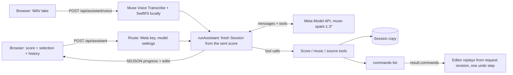

# Agent architecture review

Written 1 November 2026 against `main` at `9bd25e3`, plus the staged fixes for the replay revision and transcription placement. This is a review only. No code was changed, and no paid API calls were made. Claims about the code cite files and lines. Claims about Meta's products cite pages read on 1 November 2026. Where a source is secondary (press or blogs, not Meta), it says so.

**Status, 1 November 2026:** recommendations 1, 2 and 3 are done. The agent now runs on the Responses API and carries its encrypted reasoning between steps, with nothing stored at Meta ([measured](reasoning-continuity.md): as accurate, faster, slightly cheaper). A turn's edits have one owner (`modules/assistant/application/turn-edits.ts`), which checks that the commands replay to the agent's score before the turn returns. Model calls are retried on 429, 5xx and dropped connections, and a stream that stops before its end is caught (`modules/assistant/infrastructure/model-retry.ts`). Line numbers below refer to the code before those changes.

The product owner asked:

- Is there a foundational problem in how the agent is built?
- Are we following good practice, with the right framework and SDKs, for an agentic, multimodal product?
- Do we use multimodal capabilities at all?

## Verdict

**No foundational problem in the core design.** The central choices hold up:

- A deterministic score engine and typed, revision-checked operations.
- The model only requests changes; it never holds state.
- A local "ear" for pitch and rhythm.
- A provider-neutral `ModelPort`.
- Evaluations that run against the real model.

That design is also the right hedge against Meta's platform churn this year (see [Meta ecosystem](#meta-ecosystem-november-2026)).

The problems are one level down, and they are cheap to fix:

1. **The agent forgets its own reasoning between steps.** The default Chat Completions path cannot carry reasoning across turns for external API keys. The Responses adapter could, but it drops the reasoning. Every step re-thinks from scratch, and steps are where turn time goes (20–30 s each, 5–18 per page).
2. **Two copies of the turn's state agree only by convention.** The server session and the command list the browser replays are kept in step by hand in three places. Today's replay bug came from exactly this. The design itself (a throwaway server copy, the browser's score authoritative, editing locked during a turn) is sound. It lacks an invariant check.
3. **Model calls are not resilient.** There is no retry on 429/5xx, and a cut-off Chat Completions stream is taken as a finished answer. A single transient error kills a 7-minute page read.
4. **One fact lives in several places.** The rule "which notation the score supports" is written in four places, so they drift (evidence 4: triplets).
5. **Thin regression net on the voice path.** Only 3 of 191 archived takes have ground truth, and no agent-level eval runs over them routinely.

**Multimodality:** pictures and PDFs reach the model. Audio never does, and that was decided on measured evidence. Spark 1.2 heard the wrong notes, and 1.3 returned nothing ([melody-transcription.md](melody-transcription.md) lines 9–15). Meta's own docs still warn that Spark 1.3 audio is degraded. Native audio is worth one bounded experiment, for telling speech from singing only, not for notes.

**Framework:** Meta ships **no SDK** for its Model API and **no agent framework** of its own. Llama Stack became the vendor-neutral OGX, and the hosted Llama API was shut down on 6 July 2026 (secondary sources). Keeping the hand-written loop is right. Swapping the hand-written wire code for the `openai` npm client, which Meta's own docs recommend, is optional; it would be an HTTP-client choice, not a provider change.

## How a turn works today

- **Server:** stateless per request. `runAssistant` builds a `Session` from the score the browser sent (`modules/assistant/application/run-assistant.ts` lines 102–108). It loops until the model stops calling tools, asks a question, or hits the step cap: 12 steps, or 24 with attachments (lines 28–30, 187–235).
- **Browser:** authoritative. It locks the editor while a turn runs (`modules/workspace/ui/components/WorkspaceScreen.tsx` line 57). It replays `result.commands` from the request's revision as one undo step (`modules/assistant/ui/hooks/use-assistant.ts` lines 141–149). Edits stream as `edits` events for a live preview (`application/edit-feed.ts`).
- **Model adapter:** hand-written `fetch` and SSE parsing over Chat Completions (the default) or the Responses API (`infrastructure/meta-model.ts`, `meta-stream.ts`, `meta-responses.ts`). It has an idle timeout and no retries.

## Multimodality today

| Input | Reaches the model as | Where |
| --- | --- | --- |
| Typed words | Text | `application/opening-messages.ts` 25–33 |
| Spoken words | **Text only.** Muse Voice Transcribe turns with ms times, rendered as a take timeline (`said: "…"`) | `modules/voice/infrastructure/muse-transcriber.ts`; `modules/voice/domain/timeline.ts` 26–39 |
| Singing | **No audio.** SwiftF0 (MIT ONNX, server-side) plus local domain code find spans, notes and rhythm. The model sees span IDs and lengths, then calls `voice_*` tools that return notes and evidence as JSON | `modules/voice/infrastructure/swift-f0.ts`; `application/music-tools.ts`, `voice-transcription-tool.ts` |
| Pictures of sheet music | **Image parts.** Labelled pictures from the notehead detector are shown again after the tool results, plus the detected heads as text | `application/attachments.ts` 69–85; `infrastructure/meta-model.ts` 46–50; `application/source-reading-tool.ts` 77–90; `run-assistant.ts` 132, 227–229 |
| PDFs | **File parts**, read by eye only. The detector runs on pictures only | `source-reading-tool.ts` 69–71 |
| Text files (ABC, chord charts) | Inline text | `attachments.ts` 72 |
| The score | Score text in the first user message | `opening-messages.ts` 39–50 |
| Output | Text and tool calls. No speech output | — |

**What Meta's models support** ([model catalog](https://dev.meta.ai/docs/models), read 2026-11-01):

- Muse Spark 1.1–1.3 and Muse Wonder 1.0 take text, image, video, audio and PDF, with a 1M-token context, and output text only.
- The 1.3 entry says audio "is not fully supported… responses may be degraded", and recommends 1.2 or Muse Voice Transcribe instead. The [audio/video guide](https://dev.meta.ai/docs/video-understanding) repeats that warning and uses 1.2 in its audio examples. Audio formats are WAV and MP3, sent as `input_audio` parts.
- Muse Voice Transcribe has turn-level timestamps, but no word timestamps, confidence or sound-event detection ([speech to text](https://dev.meta.ai/docs/speech-to-text)).
- The catalog lists no text-to-speech or speech-to-speech model.

**What native audio would change, and what it would not:**

- **Notes and rhythm: no.** The repo measured it. Spark 1.2 heard C D E G C for C E G E D F A, with timestamps off by 0.5–3 s. Spark 1.3 returned nothing ([melody-transcription.md](melody-transcription.md) lines 11–12). The local ear is the right tool, and it is measured (`yarn eval:voice`, `yarn eval:rhythm`).
- **Telling speech from singing: possibly.** The recognizer writes short sung syllables down as words. The fix today is a hand-built heuristic ([detached sung syllables](../solutions/voice/detached-sung-syllables-read-as-speech.md)). Spark 1.2 found the spans correctly in the one measured take. A tool that asks a Meta model "is this short clip speech or singing?" only for spans the heuristics find ambiguous is a Meta-first candidate. It needs evaluation on labelled takes first (recommendation 9).
- **Style and intent ("swing it", "like a lullaby"):** this would be speculative. Nothing in the corpus shows the agent failing for lack of hearing the tone.

**Vision is used well.** The model cannot place noteheads ([sheet-reading.md](sheet-reading.md) line 72), so a detector labels them, and the model reads the labelled picture with the heads as text. That is the right split between perception and reasoning. One gap: PDFs skip the detector.

## Meta ecosystem, November 2026

| Offering | Status (source, date) | Fit for Amanuensis | Used here? |
| --- | --- | --- | --- |
| **Meta Model API** (`api.meta.ai/v1`) | Public preview since 8 July 2026, **US developers**, self-serve, OpenAI-SDK compatible, $1.25 / $4.25 per M tokens ([Meta blog](https://dev.meta.ai/resources/blog/build-with-muse-spark/), 2026-07-08) | Yes: the only first-party hosted path | Yes (`meta-model.ts` line 16) |
| **Muse Spark 1.1–1.3** | Closed model from Meta Superintelligence Labs, launched 8 April 2026 (secondary: [eWeek](https://www.eweek.com/news/meta-muse-spark-ai-launch-multimodal-reasoning/), [Daily Star](https://www.thedailystar.net/news/tech-startup/news/meta-races-toward-personal-superintelligence-muse-spark-launch-4147666)); 1.3 recommended for new work ([catalog](https://dev.meta.ai/docs/models)) | Yes: the main loop | Yes. Default `muse-spark-1.3`; the research notes say `muse-spark-1.3-contributor` is the model in use ([assistant-streaming.md](assistant-streaming.md) line 3) |
| **Muse Wonder 1.0** | Preview ([catalog](https://dev.meta.ai/docs/models)). Meta's agent guide recommends it for the main loop and Spark 1.3 for subagents ([agent frameworks](https://dev.meta.ai/docs/agent-frameworks)) | Measured for page reading: no better on pitch, at about 4× the price ([sheet-reading.md](sheet-reading.md) 166–186). Not measured for voice or text edits | Evaluated, not used |
| **Muse Voice Transcribe 1.0** | File and realtime WebSocket ASR; turn-level times; keyword biasing; 25 languages ([speech to text](https://dev.meta.ai/docs/speech-to-text)) | Yes, for words | Yes, file endpoint (`muse-transcriber.ts`) |
| **Responses API** | Server state (`previous_response_id`) or stateless encrypted reasoning replay; reasoning summaries; `background` mode; built-in `web_search` ([Responses](https://dev.meta.ai/docs/protocols/responses)) | Yes: Meta's recommended path for tool loops | Adapter exists, off by default, and drops reasoning |
| **Official Meta SDK** | **None.** "Meta Model API doesn't need a client of its own"; the docs point to the OpenAI SDK, the Anthropic SDK and LiteLLM ([SDKs](https://dev.meta.ai/docs/sdks)) | — | Hand-written `fetch` |
| **Meta agent framework** | **None.** The agent guide documents the Claude Agent SDK (Messages format) and the OpenAI Codex app-server (Responses format) ([agent frameworks](https://dev.meta.ai/docs/agent-frameworks)) | See [Framework](#framework-and-sdk) | Hand-written loop |
| **Llama API** (`api.llama.com`) | **Retired 6 July 2026**; developer pages redirect to dev.meta.ai (secondary: [Spheron, 2026-09-26](https://www.spheron.network/blog/meta-shut-down-the-llama-api-self-hosting-llama-is-now-offic/), [TMTPost](https://www.tmtpost.com/agent/ai-article/18899)). No Meta notice was found | Not an option | No |
| **Llama Stack** | Renamed **OGX** on 28 April 2026 and made model-agnostic (23 providers). The old Agents API was removed in favour of Responses ([OGX blog](https://ogx-ai.github.io/blog/from-llama-stack-to-ogx), 2026-04-28; [repo](https://github.com/llamastack/llama-stack)). Meta's role today is not stated | Poor: a Python server between Next.js and the Model API, with no capability we lack | No |
| **Muse Glimmer / Muse Spark Open** | Open-weight, self-hosted, not on the Model API ([catalog](https://dev.meta.ai/docs/models)). Release dates come only from secondary blogs and disagree | Not now: we have no inference hosting, and nothing needs it | No |
| **SAM 3.1 (hosted) / SAM Audio** | Image/video segmentation; audio separation is open-source only ([models-and-voice.md](models-and-voice.md) 14–15) | SAM Audio only if noisy takes become a measured problem | No |

**Platform risk.** In 2026, Meta shut its Llama API, released a closed model family under a new API, and saw its agent stack leave the brand. The Model API is still a US-only preview. Two things protect this app:

- the `ModelPort` boundary (`application/model-port.ts` 36–42), which no application code goes around;
- the fact that the Model API speaks OpenAI and Anthropic wire formats.

Keep both.

## Architecture against good practice

### State ownership: server sandbox, client replay

**Sound in principle.**

- The server is a speculative sandbox. Nothing is persisted there, and the browser's score is the only authority.
- The editor is locked while a turn runs (`WorkspaceScreen.tsx` 57), so no concurrent writer exists.
- Note IDs come from request IDs, so replay is deterministic.
- This is how drag previews work in the editor too.

**Fragile in practice.** The rule "every session change adds exactly one command, and every effective undo removes one" is kept by hand in three write paths:

- the `commit` closure for music and source tools (`run-assistant.ts` 117–128);
- `runScoreTool` for `score_edit` and `score_write` (`score-tool-call.ts` 70, 88), and `score_undo` (line 95);
- the `<score>` block writer, which routes through `runScoreTool` (`run-assistant.ts` 161–167).

The revision each recorded command expects was derived from the session until today's fix (`recordCommand`, `score-tool-call.ts` 36–38). `travel` gives an undo a *new* revision (`modules/score/application/session.ts` 51–60), which is what broke the replay. Undo inside a turn is not rare: `score_undo` appears 17 times across the 191 archived take results.

Today's fix is correct, but the next new write path can break the rule again, and the failure surfaces in the browser as "The score changed while I was working". That message blames the musician for a server bug.

**Recommendation 2** makes the rule structural: one owner, plus a self-check before returning.

Two other notes:

- The server trusts the score the client sends. It does run it through `parseScore`, which is fine for a single-user, local-first app.
- [system-design.md](../architecture/system-design.md) still describes a server-persisted, authoritative snapshot, which the implementation does not have. The doc should say which is current.

### The tool loop

The hand-written loop (`run-assistant.ts`, 240 lines) is the right call here. Most of its lines are domain-specific, and no framework would provide them:

- the heard-bars guard;
- labelled pictures injected after tool results;
- `<score>` block drafts;
- step caps by turn type;
- command bookkeeping;
- progress events that never carry the model's text.

What a framework would add (retries, typed stream events, tracing hooks) is cheap to add directly (recommendations 3 and 7). Good things to keep:

- One tool call per step (`parallel_tool_calls: false`, `meta-model.ts` 71 and 85). Meta's docs say the only bound on function calls is this setting plus your own loop cap ([tool calling](https://dev.meta.ai/docs/tool-calling)).
- Hard step caps that keep partial work (lines 231–235).
- Stop that keeps what is already shown (`use-assistant.ts` 163–176).

### Tool design

**Good:**

- A small surface of about 11 tools, and source tools only when files are attached. Meta's `tool_search` is not needed at this size.
- Coarse `score_write` (bars as text) next to precise `score_edit` (typed operations).
- Schemas generated from the same Zod schemas that validate calls, so they cannot drift (`tool-definitions.ts` 117–122).
- Idempotency receipts by request ID (`session.ts` 19–34).
- Errors that teach: the closest union branch is reported, and fields are pointed to the operation that takes them (`score-tool-gateway.ts` 160–193).

**Measured friction.** Over the 191 archived voice-turn results (aggregate counts only; the takes span several code versions):

- 50 of 398 tool calls failed. `score_edit` failed 38 of 122 times.
- About 11 of those were the heard-bars guard working as designed.
- 6 were the opaque "Invalid tool arguments at operation: Invalid input".
- 4 were stale revisions.

Inside one turn the agent is the only writer, so the `expectedRevision` it must copy forward guards only against its own bookkeeping (recommendation 6).

**Capability knowledge is duplicated.** The triplet-meter rule appears in four places:

- `modules/score/domain/tuplets.ts` 50 (the real rule);
- `modules/score/domain/operations/measure-schemas.ts` 98;
- `UNSUPPORTED_NOTATION` in `score-tool-gateway.ts` 21–28;
- the free-text regex table `APPROXIMATIONS` in `source-reading-tool.ts` 17–28.

Evidence 4 (triplets forced into approximations) is this kind of drift (recommendation 4).

### The model wire

| Topic | Finding | Evidence |
| --- | --- | --- |
| Reasoning continuity | Lost on every step. "Chat Completions cannot carry reasoning across turns for external API keys" ([reasoning](https://dev.meta.ai/docs/reasoning)). The Responses adapter sends neither `include: ["reasoning.encrypted_content"]` nor `previous_response_id`, and drops `reasoning` output items | `meta-model.ts` 61 (`api = "chat"` default), 64–75; `meta-responses.ts` 25–56, 59–77 |
| Retries | None. Any non-OK status fails the turn | `meta-model.ts` 109–113 |
| Truncated stream | Chat Completions returns whatever arrived, without checking for `[DONE]` or a finish reason. Responses does check | `meta-stream.ts` 46–58 vs `meta-responses.ts` 110 |
| Idle timeout | Good: resets on each chunk; 180 s for long reasoning | `meta-model.ts` 23, 93–100 |
| Prompt caching | Good: stable system prompt and tools first, score context in the user message | `run-assistant.ts` 171–175 |
| Images re-sent each step | Pages are re-sent on every step (135k–570k input tokens per page, mostly cached). Server-side state would avoid this | [assistant-streaming.md](assistant-streaming.md) line 202 |

### Streaming

The work is well researched and fits the API's behaviour: no reasoning stream on Chat Completions, tool arguments arriving whole, and text streaming only on Responses when tools are offered ([assistant-streaming.md](assistant-streaming.md)). Live edits per step are the real gain, and they exist. **Keep as is.**

### Step limits and long turns

- The caps of 12 and 24 differ from the proposed 8 in [system-design.md](../architecture/system-design.md) line 137. Update the doc, not the code.
- Page reads of up to 7 minutes run inside one HTTP request (`maxDuration = 600`, `app/api/assistant/route.ts` 8). That is fine locally. On a serverless host it is fragile; Meta's Responses `background` mode or a job model would be the durable form (recommendation 10).

### Evals and regression corpora

This is better than most teams manage:

- Prompt-rule ablations with a rule that a prompt line needs a failing case ([prompt-rules-eval.md](prompt-rules-eval.md); `code-conventions.md` AI-first).
- Sheet-agent evaluation on fixture pages.
- Free local ear evaluations.
- A per-take paid smoke run with ground truth (`scripts/voice-smoke.mts`).
- A scripted-fake loop test suite (`tests/unit/assistant-loop.test.ts`).

Gaps:

- Only **3 of 191** archived takes have `truth.json`.
- No routine agent-level run over the labelled takes.
- No recorded model replies, so a change to tools or the gateway cannot be regression-tested through real agent decisions without paying.
- Prompt-rule cases are clear typed requests on a 4-bar song, 3 runs each (the doc says so itself).

### Observability

Development only. `logTurn` prints one line per turn, plus each call (`infrastructure/turn-log.ts`; `route.ts` 32). The `trace` goes back to the browser in the result. Nothing is kept by turn ID, and nothing runs in production. The model ID and reasoning effort are not recorded per turn, so a model change cannot be tied to a quality change.

### Prompt management

The system prompt is a short TypeScript constant (`application/system-prompt.ts`), with tool descriptions doing most of the work. The eval-gated rule policy is good practice. **Keep as is.** One addition: record a prompt hash with each traced turn (recommendation 7).

### Safety and cost guardrails

- Prompt-injection posture is sound. Text in the score is "never instructions" (`system-prompt.ts` line 12), and tools are bounded to the open song, with undo.
- **The routes have no authentication, rate limit or per-turn token budget** (`app/api/assistant/route.ts`, `voice/route.ts`). Whoever reaches a deployment spends the Meta key. That is fine on localhost, and a blocker before any shared deployment.

### Documentation drift (low cost, worth fixing)

- [delivery-plan.md](../planning/delivery-plan.md) line 3 still says "Planning is the current task… No application implementation".
- The same plan (lines 25, 61) offers count-in, which the product has since ruled out.
- The SwiftF0 exception to the Meta-first policy is justified with measurements only in commit `755ae27`, not in a decision record. [system-design.md](../architecture/system-design.md) line 50 asks for one.

## Framework and SDK

| Option | What it gives | What it costs | Meta-first? | Verdict |
| --- | --- | --- | --- | --- |
| **Keep the hand-written loop and wire code** (today) | Full control of domain hooks; no dependencies | Retries, SSE edge cases and tracing are ours to write | Yes | **Keep the loop.** Fix the wire (recommendation 3) |
| `openai` npm client pointed at `api.meta.ai/v1` | Maintained SSE parsing, retries with backoff, typed errors and stream events for both Chat Completions and Responses | One dependency; the adapter is rewritten, but `ModelPort` stays | Meta's own recommended client; data goes only to Meta. Record it as a deliberate choice | **Optional**, about 1 day; replaces about 320 lines |
| Vercel AI SDK / OpenAI Agents SDK (JS) | Generic loop, tracing hooks, multi-provider | Our loop's domain hooks (guard, shown pictures, blocks, commands) fight the abstraction | Client libraries only | **No.** Adds abstraction without removing work |
| Claude Agent SDK via Meta's Messages format | Mature agent runtime, documented by Meta | Built for coding agents with file and shell tools; Node subprocess model | Client only, but an Anthropic runtime | **No** |
| OGX (ex-Llama Stack) | Server-side Responses, vector stores, multi-provider | A Python server hop; Agents API removed; no longer Meta-branded | Ambiguous | **No** |

## Recommendations, ranked

Effort: S ≈ 1–2 days, M ≈ 3–5 days, L ≈ more than a week. All of them stay Meta-first unless noted.

| # | Change | Why (evidence) | Effort | Risk |
| --- | --- | --- | --- | --- |
| 1 | **Carry reasoning across steps.** In the Responses adapter, send `store: false` with `include: ["reasoning.encrypted_content"]`, and replay `reasoning` items with the history. Then measure `yarn eval:sheet-agent`, `eval:prompt-rules` and `smoke:voice` on Responses against Chat Completions, and switch the default if it is no worse. Alternative: `previous_response_id`, which also stops re-sending page images, but keeps data at Meta | Meta: Chat Completions "cannot carry reasoning" for external keys; Responses is the recommended path "for tool loops". The adapter drops reasoning (`meta-responses.ts` 25–77). Steps take 20–30 s and pages need 5–18 | S plus eval runs (paid) | Low–medium: bigger payloads; check the request size cap with images |
| 2 | **One owner for the turn's edits, with a self-check.** A small `TurnTransaction` (session, command log, undo) used by every write path. Before returning, replay `executeAll(createSession(request.score), commands)` and compare its content (revision aside) with the session. On mismatch, fail on the server with the trace, never in the browser | Today's replay bug; the rule is kept by hand in 3 paths (`run-assistant.ts` 117–128, 161–167; `score-tool-call.ts` 36–38, 70, 88, 95); 17 in-turn undos in the archive | S–M | Low. Keep the overall design |
| 3 | **Resilient model calls.** Bounded retries with backoff and jitter on 429, 5xx and network errors before the first byte (model calls have no side effects); fail a Chat Completions stream that ends without `[DONE]` or a finish reason; optionally move the wire to the `openai` npm client | `meta-model.ts` 109–113; `meta-stream.ts` 46–58; turns run up to 7 minutes | S | Low |
| 4 | **One notation-support registry** in the score domain, read by the gateway's not-yet-supported list, the source tool's approximations and the tool descriptions; replace the regex table with structured `unsupported` kinds in `music_read_source` | Triplet rule in 4 places (see Tool design); evidence 4 | S | Low |
| 5 | **Agent-level regression net for voice.** Label more takes (`truth.json`; 3 of 191 today). Add an `eval:voice-agent` that runs every labelled take through `handleVoiceRequest` and reports notes right, steps, tool-error rate and tokens. Record model replies per run, so changes to tools and the gateway can be replayed without paying. Run it before any model or prompt change | Thin ground truth; prompt-rule cases are simple; Meta changes model versions often | M | Low. Never commit take audio; keep truth files local like `.takes/` |
| 6 | **Remove avoidable tool errors.** Let the in-turn gateway fill `expectedRevision` when it is missing (keep the check for the editor path), and make the union error name the closest operation instead of "Invalid input". Track the tool-error rate in recommendation 5 | 50 of 398 calls failed; `score_edit` 38 of 122; 4 stale revisions and 6 opaque union errors | S | Low; measure before and after |
| 7 | **Turn traces you can query.** Keep one JSON record per turn (turn ID, model ID, effort, API, prompt hash, per-step ms and tokens, tool names, ok/error) in development like `.takes/`, and as structured logs in production. No transcripts or audio by default, per [system-design.md](../architecture/system-design.md). Adopt OpenTelemetry GenAI conventions later, if a backend is chosen | Today it is a dev console line only (`turn-log.ts`); model changes cannot be tied to quality | S–M | Low |
| 8 | **Guardrails before any shared deployment:** authentication on both assistant routes, a per-user rate limit, a per-turn token budget (usage is already summed, `run-assistant.ts` 194–196), and Meta's `safety_identifier` | No auth or limits in `app/api/assistant/*` | M | Low |
| 9 | **One bounded native-audio experiment.** On the labelled takes, ask Spark 1.2 and Wonder only "speech or singing?" for spans the heuristics find ambiguous, against the local classifier. Adopt it only as a tie-breaker tool if it wins. Separately, rasterize PDF pages so the notehead detector runs on them | The model's notes were measured wrong; the syllable heuristic is fragile; PDFs are read by eye (`source-reading-tool.ts` 69–71) | S (experiment), M (PDF) | Low; the experiment is paid but small |
| 10 | **Durable long turns** when deploying: Responses `background` mode or a job ID with polling for page reads, so a dropped connection does not lose minutes of work | 7-minute page turns in one request (`route.ts` 8) | M | Medium; this is a deployment decision |

**Keep as is:**

- `ModelPort` and its scripted fakes.
- The deterministic engine and typed operations as the only mutation path.
- The local ear (SwiftF0 plus the domain) for notes, with Muse Voice Transcribe for words.
- The detector-plus-vision split for pages.
- Single-step tool calls with hard caps.
- Act, don't ask, with undo.
- Stop that keeps what is shown.
- Eval-gated prompt rules.
- Not adopting an agent framework.

**Do not do:**

- Do not put raw audio in the main loop.
- Do not move to OGX or Llama Stack.
- Do not switch the main model to Wonder without the voice-agent eval (recommendation 5). Meta recommends Wonder for main loops, but our page measurements did not justify 4× the price.

## Open questions for the product owner

1. **Contributor model.** `muse-spark-1.3-contributor` lets Meta use request content for training in exchange for a lower price ([catalog](https://dev.meta.ai/docs/models)). Requests carry musicians' songs, transcripts of their takes and pictures of their sheet music. Is that acceptable for users, or only during development?
2. **Regions.** Meta's launch post says the Model API preview is for US developers ([blog](https://dev.meta.ai/resources/blog/build-with-muse-spark/), 2026-07-08). What is our access basis, and are EU musicians a launch market? If they are, Meta-first needs a confirmed path, or a documented exception.
3. **Server-side state at Meta.** `previous_response_id` (Meta keeps the conversation) or stateless encrypted reasoning (nothing stored)? This decides how recommendation 1 is built, and is also a retention question.
4. **Is a third-party HTTP client (`openai` npm) inside Meta-first?** Recommended: yes, recorded as a decision, since no data goes elsewhere.
5. **Accounts and persistence.** When songs are stored on a server, authority moves there, and the client-replay design (recommendation 2) becomes a server transaction. Is that on the roadmap?
6. **Budgets.** What latency and cost per turn are acceptable for a page read (today 25 s to 7 minutes, and up to 570k input tokens per page) and for a voice turn (median 2 steps, about 29k input tokens in the archive)?
7. **Labelling time.** Recommendation 5 needs someone to write ground truth for more takes. Who does it, and how many takes are enough? Suggested: 30, across voices and styles.

## What was not verified

- Exact Meta request-size limits for inline images on the synchronous Responses API. The 1 MiB cap found applies to `background` mode, per the Responses page.
- Whether Meta's Responses page or its audio guide is right about `input_audio` on Responses: one omits it, the other documents it.
- The retirement date of the Llama API and the Muse Glimmer / Spark Open release dates. Only secondary sources were found.
- Whether reasoning continuity actually shortens our steps. Recommendation 1 measures it.
- The archive figures. They mix code versions from 27 October to 1 November and cover voice turns only.
