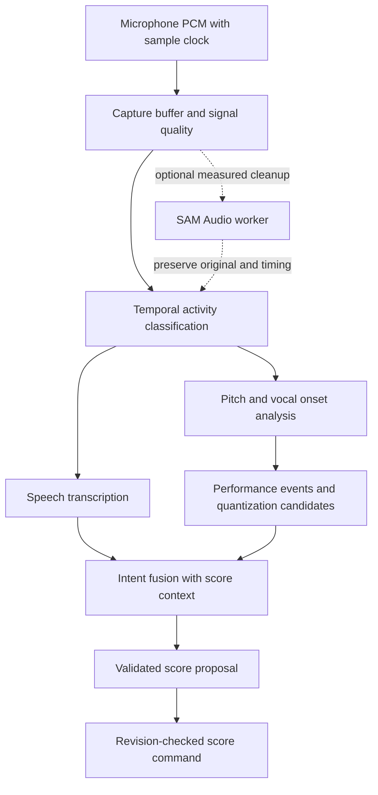

# Models and voice interpretation research

Research checked 2026-10-26. This document distinguishes documented capabilities from Amanuensis proposals. No provider calls, account entitlements, accuracy benchmarks, or latency measurements have been tested in this repository.

## What the sources establish

| Component | Verified capability | Architectural consequence |
| --- | --- | --- |
| Muse Spark | Meta documents hosted agentic models, including tool calling and structured output. Current model listings include Spark 1.3, 1.2 and 1.1. [Model catalog](https://dev.meta.ai/docs/models) | Use Spark for intent interpretation and bounded score operations; pin and evaluate a version. |
| Meta Model API | The documented base URL is `https://api.meta.ai/v1`; authenticated requests use a model API key. [API overview](https://dev.meta.ai/docs/overview) | A documented API exists; availability to this project's account still needs a smoke test. Keep credentials on the server. |
| Developer-defined tools | The application defines JSON-schema functions, executes model-requested calls, and returns results. The model does not execute those functions itself. [Tool calling](https://dev.meta.ai/docs/tool-calling) | The score engine owns validation and mutation. A model output is a request, never direct database authority. |
| Spark audio input | Audio is documented, but the audio guide explicitly warns that 1.3 audio is not fully supported and may have degraded quality; its audio examples use 1.2. [Audio guide](https://dev.meta.ai/docs/video-understanding) | Prefer a text/structured-evidence orchestrator initially. Evaluate 1.2 separately if direct audio understanding adds value. Do not infer musical transcription accuracy from audio support. |
| Muse Voice Transcribe | `muse-voice-transcribe-1.0` provides live WebSocket and file transcription, turn detection, speaker labels, vocabulary biasing, and partial transcripts. It provides turn-level timing, but no word timing, confidence scores, or sound-event detection. [Speech guide](https://dev.meta.ai/docs/speech-to-text) | Useful for spoken musical instructions; insufficient as the speech/singing classifier or note extractor. |
| SAM Audio | Prompted audio separation produces target and residual audio. The official repository provides inference code and gated checkpoint access; Python 3.11+ and a CUDA GPU are documented/recommended. [Official repository](https://github.com/facebookresearch/sam-audio) | Optional noise cleanup in a worker, after measurement. It is not a score transcriber. |
| Hosted SAM | The hosted SAM guide describes SAM 3.1 image/video segmentation. [SAM API guide](https://dev.meta.ai/docs/sam/overview) | Do not confuse that API with SAM Audio. A first-party hosted SAM Audio endpoint was not established by this research. |

Meta's SAM Audio announcement describes text, visual and span prompts, with limitations on separating highly similar sources. Its reported throughput is a research result, not an Amanuensis browser or deployment latency guarantee. [Announcement](https://ai.meta.com/blog/sam-audio/)

The name in the proposal should be **Muse Spark**, not “Muser Spark.” Model families and availability are changing; recheck the cited docs when starting integration.

## Proposed separation of responsibilities

**Meta-first selection policy:** use Muse Spark for orchestration and Muse Voice Transcribe for ASR, subject to the integration gates below. Evaluate Meta audio representations for activity classification when an appropriate supported model is accessible. Introduce a specialist outside Meta only for a demonstrated capability gap (such as calibrated F0/onset extraction), unavailable access, or a measured accuracy/latency failure on the project's corpus. Record the reason and comparison in a decision log; preserve a provider-neutral port so a suitable Meta model can replace it later. “Meta-first” does not require calling SAM Audio on clean voice or using a general reasoning model as a pitch detector.

Three questions need separate answers:

1. **What happened acoustically?** Speech, singing/humming, vocal rhythm, silence, noise, or uncertain/mixed activity, with time spans.
2. **What music was performed?** Pitch contour, voiced/unvoiced regions, onsets, offsets, timing, and uncertainty.
3. **What change did the musician intend?** Insert this melody, replace a selection, transpose, alter rhythm, add expression, or ask a musical question.

ASR answers part of the third question. Fundamental frequency estimation answers part of the second. Neither alone resolves the first. A sung word such as “stop” may be a lyric; a spoken “C sharp” may be a command. Speech also contains pitch, so stable F0 is evidence rather than a sufficient classifier.

### Proposed pipeline

All following choices are proposals, not verified model capabilities:

- Capture one person's unaccompanied voice, initially in short push-to-talk takes. Preserve original sample rate and sample-index timebase; derive resampled copies for individual analyzers. Keep an explicit mapping back to the original timeline.
- Record the actual device settings. Request reduced voice processing where supported, but do not assume browsers honor requests or that noise suppression preserves singing. Compare capture settings empirically.
- Start with explicit **Auto / Speak / Sing** mode hints. Auto remains the goal; manual hints make ambiguous passages recoverable. Do not market full automatic separation until the mixed-utterance benchmark passes.
- Classify temporal spans using acoustic features/learned embeddings plus context, with hysteresis and an `uncertain` class. Retain overlapping candidate labels until adjudication. ASR can run speculatively, but its output must not automatically become a command.
- Feed speech candidates to Transcribe with music vocabulary hints. Bind final transcripts to their turns; partials are UI feedback, not committed commands. Establish an adapter for the provider's turn events and test out-of-order finalization.
- Extract continuous F0 independently of the language model. Compare a probabilistic DSP baseline and a neural monophonic estimator. CREPE's authors provide a monophonic neural pitch tracker; it is an evaluation candidate, not a notation renderer. [CREPE repository](https://github.com/marl/crepe)
- Convert F0 into note candidates using voiced probability, pitch change, amplitude/articulation cues and duration. Preserve vibrato/portamento as contour evidence instead of splitting every fluctuation into notes. Repeated notes at the same pitch require onset evidence.
- Derive rhythm from performed timing and explicit tempo/meter instructions. Offer count-in/metronome support. Free singing often does not uniquely determine tempo, meter, pickup position, or note spelling; keep alternatives and ask one targeted question when needed.
- Quantize into rational musical durations only after capturing raw performance. Store measured seconds and inferred beats separately. Never silently reinterpret user-corrected notes when reanalyzing a take.
- Fuse the transcript, candidate music, selected score region, current revision, and user constraints into a compact intent representation. Spark chooses among bounded score tools. Do not ask it to invent unmeasured pitch values.
- Exclude instrument and mixed-track import. If accompaniment or multiple performers are detected, request an unaccompanied take. Microphone-only input cannot guarantee that a user has not played a recording into the microphone; this is a supported-input boundary with best-effort detection.

SAM Audio should remain outside the initial critical path. Separation may alter the onset/pitch evidence Amanuensis needs, and its deployment adds cost. Enable it only when before/after evaluation demonstrates improvement for noisy voice without harming clean takes.

## Proposed evidence contracts

Keep provider responses behind adapters; the following are conceptual records, not implementation code:

| Record | Required information |
| --- | --- |
| Capture | Capture ID, original format/sample rate, sample count, device settings, recording status, retention state |
| Activity span | Stable span ID, sample start/end, candidate classes, classifier version, uncertainty |
| Speech evidence | Span/turn references, final transcript, language hint, provider/model version; no fabricated ASR confidence |
| Performance evidence | Time/F0 contour, voiced score, onset/offset candidates, raw source reference, extractor version |
| Musical candidate | Notes/rests, rational timing, tempo/meter assumptions, alternative interpretations, evidence references |
| Intent | Action, target IDs, current score revision, explicit constraints, unresolved question, candidate ID |

Distinguish a model's uncalibrated score from a probability. Measure calibration before displaying confidence percentages. Prefer an actionable indicator such as “Check the last two notes” over arbitrary precision.

## Evaluation before committing to the stack

Create a consented, versioned corpus with performer-disjoint development and held-out sets. Include speech-only musical instructions, humming, sung syllables, lyrics, alternating speech and singing, rapid transitions, rests, repeated pitches, vibrato, slides, octave leaps, quiet/breathy voices, room noise, different microphones, and unsupported accompaniment. Label acoustic spans and intended score operations separately.

| Question | Measure |
| --- | --- |
| Did we preserve the command/performance distinction? | Per-class precision/recall, boundary error, uncertain rate, sung content incorrectly executed as a command |
| Did we capture pitches? | Voiced F0 error in cents, octave error, voiced/unvoiced error; report per performer/device |
| Did we produce notes? | Note onset/pitch F1 with and without offsets, missed/repeated notes, false splits |
| Did we infer notation? | Beat/duration accuracy, meter/tempo alternatives, correct enharmonic spelling given key/context |
| Did the agent respect the user? | Correct action and target selection, adherence to constraints, correction preservation, stale-revision rejection |
| Is the experience useful? | Corrections per phrase, time to acceptable score, musician preference, request latency p50/p95 and cost per take |

Use established note matching tolerances as one reproducible baseline: 50 ms onset, 50 cents pitch, and offset tolerance of the larger of 50 ms or 20% of note duration. These are evaluation tolerances, not an acceptable UI delay or a product quality promise. [mir_eval transcription documentation](https://mir-eval.readthedocs.io/latest/api/transcription.html)

Before setting launch thresholds, collect baseline results and review failures with musicians. Report performance for mixed speech/singing separately from clean humming; averaging them hides the core product risk. Run ablations for ASR-only interpretation, acoustic-only classification, combined evidence, explicit modes, and SAM cleanup.

## Unresolved integration gates

1. Obtain project API access and verify one text tool loop, one file transcription and one real-time session using the actual account. Published docs do not establish entitlement, quotas, regional availability or measured reliability.
2. Benchmark musical vocabulary, singing contamination of ASR and command false positives. Transcribe's speech endpointing is not a singing detector.
3. Select and benchmark the activity classifier and pitch/onset extractor. No inspected Meta source establishes an end-to-end voice-to-notated-score model.
4. Validate sample-clock alignment through resampling, provider timing, optional separation and quantization.
5. Define audio retention and deletion behavior before collecting real user takes; use Standard provider mode by default and verify account-specific data settings.
6. Choose a long-lived gateway/worker deployment for real-time sessions rather than assuming a request-bound Next.js handler can host durable WebSockets and GPU inference.
7. Treat model migration as a regression-tested change. Keep the voice analysis and orchestration versions independently configurable.
